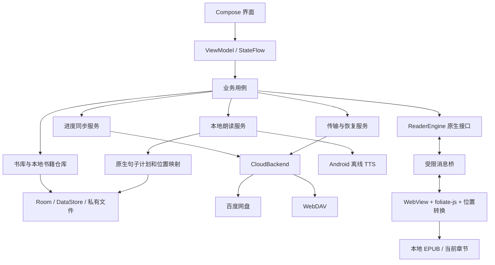

# Android 阅读 App 技术方案

文档版本：1.0

编写日期：2026-11-19

状态：新项目开发方案，尚未创建 Android 工程、安装工具链或完成原型验证。

兼容基线：BaiduPanSync 0.10.8 的现行 schemaVersion=2 云端协议；本仓库 0.10.9 仅增加本文档及版本记录，协议不变。

## 1. 目标与已确定的约束

开发一个独立 Android 阅读 App，通过百度网盘或 WebDAV，与 KOReader 上的 BaiduPanSync 插件共享 EPUB 书籍、书库列表、封面和阅读进度。

采用 **Kotlin + Jetpack Compose 原生界面、Android WebView + foliate-js 阅读内核、JavaScript/TypeScript 位置转换、Android 原生本地 TTS**。不采用纯 H5/PWA，不直接移植 Readest 整个应用，不依赖 Readest 云服务。

### 1.1 必须满足

| 需求 | 确定的行为 |
| --- | --- |
| 精准同步 | Android 与 KOReader 双向同步正文锚点，不能用百分比或页码冒充精准位置 |
| 同步通道 | 百度网盘或 WebDAV，首版不增加自建同步服务器 |
| 书籍身份 | 按实际 EPUB 文件名去掉最后一个扩展名识别，不使用内容摘要判重 |
| 同名覆盖 | 视为同一本书，覆盖正文时保留云端及本地阅读进度 |
| 使用模型 | 单用户、设备交替使用；不设计多设备同时写入的锁、租约或冲突合并 |
| 书库来源 | 日常只读独立 `library.json`，不逐书读取元数据、不自动全库扫描 |
| 缓存 | 每天首次进入书库读取列表；当天重复进入用本地缓存；主动更新可立即刷新并检查外部上传 |
| 封面 | 独立文件，首次取得后持久缓存，版本未变不重复下载 |
| 本地书籍 | 手动扫描指定目录及子目录，只登记 EPUB；同名冲突列出全部位置，不自动选一个 |
| 下载交互 | 点击封面进入详情，不自动下载；详情提供下载按钮 |
| 本地状态 | 封面角标表示本机已存在，封面下只显示书名；详情显示本地状态和位置 |
| 朗读 | **首版只做安卓本地离线朗读**，不接云端 TTS，不接在线大模型语音服务 |
| 朗读控制 | 支持暂停/继续、前后句、语速、音色、定时停止、后台及锁屏控制 |
| 故障恢复 | 正文上传成功但列表发布失败，可以仅补全列表，不重传正文 |
| 诊断 | 展示任务阶段、耗时、请求数、缓存情况及可执行的下一步 |

### 1.2 首版范围边界

- 支持无 DRM 的 EPUB，优先可重排 EPUB 2/3。PDF、TXT、MOBI、漫画及固定版式 EPUB 的完整支持另列后续任务。
- 本文中的“语音”指文字转语音朗读 TTS；语音转文字 ASR、语音指令、云端音色不在首版范围。
- 原插件的书库及同步功能必须覆盖；不要求复刻 KOReader 的所有阅读器功能，例如全部词典、排版选项和批注体系。
- 不开发 iOS、桌面客户端、多人共享、实时协同或跨百度/WebDAV 自动镜像。
- 不导入 0.10.0 之前的旧摘要身份数据；已有 0.10.x 数据继续兼容，不能要求再次清空网盘。
- 上传和应用云端进度由用户主动触发；日常本地进度自动保存，不隐式改写云端进度。

## 2. 技术选型

| 层次 | 技术 | 职责 |
| --- | --- | --- |
| 应用及界面 | Kotlin、Jetpack Compose、Material 3 | 书库、详情、设置、任务、同步对比、朗读控制 |
| 状态管理 | ViewModel、StateFlow、协程 | 单向状态流、取消和页面生命周期 |
| 阅读引擎 | Android WebView、foliate-js | EPUB 解析、分页/滚动、目录、正文搜索、定位 |
| 阅读适配 | TypeScript、本地打包的 JS 资源 | 统一引擎接口、CFI、DOM 锚点、XPointer 转换 |
| 原生与阅读器通信 | AndroidX WebKit 消息桥 | 有类型的请求/响应及阅读事件 |
| 本地朗读 | Android TextToSpeech | 调用设备已安装的离线引擎和音色 |
| 后台朗读 | 前台媒体服务、MediaSession 适配 | 通知、音频焦点、耳机、锁屏及后台状态 |
| 云端网络 | OkHttp、Kotlin 协程 | WebDAV、百度 API、文件流、超时和取消 |
| 序列化 | kotlinx.serialization | 云端协议及本地消息，不宽松接受无效数据 |
| 本地结构化数据 | Room | 书库快照、本地索引、位置、任务恢复和诊断 |
| 设置 | DataStore | 阅读选项、目录配置、后端选择 |
| 凭据 | Android Keystore + 加密的应用私有文件 | 保护令牌、WebDAV 密码和个人百度应用配置 |
| 文件 | 应用私有目录 + SAF 文档 URI | 私有缓存及用户授权目录管理 |
| 原生构建 | Gradle Wrapper、Kotlin DSL | 可复现的 Android 构建 |
| 阅读资源构建 | Node.js、TypeScript、轻量打包工具 | 构建阅读 JS，不运行前端网络服务 |

起步建议 `minSdk=26`，用于减少旧系统兼容分支；这属于本方案默认值，应在新项目根据实际手机确认。`compileSdk`、`targetSdk`、AGP、Gradle、JDK、Kotlin 和 Compose 版本在立项时选取一套官方兼容组合并锁定，不把本文中的日期当作依赖版本。

首版不需要 Rust、Tauri、Flutter、React Native 或 NDK。若位置转换验证无法通过，再评估是否引入 CREngine；不能未经评估直接把它加入首版依赖。

## 3. 总体架构



### 3.1 边界原则

- Compose 管理应用界面；WebView 只承担正文渲染与依赖 DOM 的位置计算。
- JS 不持有云端令牌，不直接调用百度或 WebDAV，也不能访问任意文件。
- 原生层管理网络、文件、数据库、任务和 TTS；不在 Kotlin 中另写一套分页排版引擎。
- 云端协议与阅读内核解耦：更换内核不能改变 `bookId` 和进度文件路径。
- 不让后台朗读依赖 Activity 或 WebView 一直存活。
- 单用户模型仍需要进程内串行写队列，防止本机重复点击互相覆盖；这不是多设备并发协议。

### 3.2 建议工程组织

初期保持少量 Gradle 模块，业务包先分清，避免为了目录结构拆出大量模块：

```text
android-reader/
  app/                        # Compose 页面、导航、依赖装配
  core/                       # 协议模型、Room、网络、文件、业务服务
  reader/                     # WebView、桥接和 ReaderEngine 适配
  speech/                     # 本地 TTS、后台服务、媒体控制
  reader-web/                 # TypeScript、foliate-js、CFI/XPointer、测试
  protocol-fixtures/          # 脱敏云端 JSON、位置测试 EPUB 和锚点
  docs/                       # 分类文档：项目总览/工程与构建/架构与协议/TTS/在线书库/服务器管理
  gradle/libs.versions.toml
  gradlew
  README.md
```

模块依赖单向组织；`reader` 和 `speech` 共享 `core` 的纯接口，不互相依赖 Activity。首个原型可把 `speech` 暂放到 `app` 内，验证通过再独立。

## 4. 与现有插件兼容的云端协议

### 4.1 路径布局

以下均为后端根目录下的相对路径；百度根目录必须在当前应用可访问的 `/apps/{appname}` 内，WebDAV 根目录由用户配置。

```text
library.json
books/
  示例书.epub
covers/
  示例书.json
progress/
  示例书.json
```

没有必须逐本读取的 `metadata/*.json`。目录中的 `books/示例书.EPUB` 也可存在，列表必须保留实际大小写路径。

### 4.2 名称身份

1. 取实际文件名，只移除末尾 `.epub`，扩展名大小写不敏感。
2. 得到的字符串作为 `bookId`，正文名称大小写敏感。
3. 不自动 trim、截断、转小写、做 Unicode 归一化或从 EPUB 内部书名重新命名。
4. `示例书.epub` 和 `示例书.EPUB` 是同名；同时出现时属于冲突，不任取一个。
5. `示例书.epub` 与 `示例书（修订版）.epub` 是不同书籍。
6. 不通过文件大小、MD5、SHA 或正文内容判定是否为同一本书。
7. 百度分片上传协议要求的 MD5 仍需计算；它是传输参数，不是书籍身份，也不写入进度身份。

云端命名校验沿用现有插件：完整 EPUB 文件名最多 255 个 UTF-8 字节，排除路径分隔符、控制字符以及 `< > : " | ? * %`，书名不得为空、点号或含首尾空格。不能按 255 个汉字计算。

本地扫描先过滤 EPUB，再按本地名称规则识别；本地已存在的合法长名称不套用云端发布的限制。上传时单独执行云端校验，不可自动改名造成进度分叉。长名称 PDF 不进入扫描校验和重名检查。

### 4.3 `library.json`

示例为当前格式，不为 Android 单独发明新协议：

```json
{
  "schemaVersion": 2,
  "coverDirectoryReady": true,
  "books": [
    {
      "schemaVersion": 2,
      "status": "ready",
      "bookId": "示例书",
      "title": "示例书",
      "fileName": "示例书.epub",
      "path": "books/示例书.epub",
      "size": 10485760,
      "uploadedAt": "2026-11-19T18:00:00+08:00",
      "coverPath": "covers/示例书.json",
      "coverVersion": "8bf8d30bb96e451cab236e154e267c5b"
    }
  ]
}
```

- `coverDirectoryReady` 是现有可选目录初始化提示；不能把它当作权限或实时存在证明。
- `title` 必须等于 `bookId`；EPUB 内部标题如需展示，只保存在本地展示信息中。
- `fileName`、`path` 保留云端实际名称，且 `path` 必须等于 `books/` 加 `fileName`。
- 无封面时同时省略 `coverPath` 和 `coverVersion`。
- 当前上限为 4 MiB、10,000 本；单本记录正文大小大于 0、不超过 1 GiB。先遵守插件上限，不单方面扩大。
- 未知可选字段应尽量保留，未知协议版本明确报错。不能反序列化后无意丢弃另一端写入的字段。
- 列表损坏时保留云端原文件和本地最后成功快照，禁止按空列表覆盖远端。

### 4.4 封面文件

```json
{
  "coverPng": "<PNG 文件的 Base64 内容>"
}
```

保持现有 PNG 缩略图协议：解码后最多 32 KiB，最大 240×320。列表中不嵌入封面内容。`coverVersion` 是不透明缓存版本；更新封面时换新值，不使用它判断书籍身份。

### 4.5 进度文件

```json
{
  "schemaVersion": 2,
  "book": {
    "id": "示例书",
    "title": "示例书",
    "format": "epub",
    "size": 10485760
  },
  "progress": {
    "type": "xpointer",
    "value": "/body/DocFragment[2]/body/div/p[3]/text().12",
    "percent": 0.315
  },
  "sync": {
    "revision": 7,
    "writeId": "cd73f37d1cb348b2b5103fc757246fe9",
    "deviceId": "android-cf7b93eb",
    "updatedAt": "2026-11-19T18:00:00+08:00"
  }
}
```

`value` 仅示意路径形态，不能作为任意 EPUB 都可用的真实定位夹具。真实测试锚点必须由目标书和实际引擎生成。

- 云端权威位置是 CREngine XPointer；Android 的 CFI 和朗读内部状态留在本地。
- `percent` 可省略，只用于显示，不用于精准定位或判定哪一端更新。
- `book.size` 是写入时的描述，不是拒绝同名覆盖进度的依据。
- `revision` 读取当前记录后递增；`writeId` 每次写入生成，`deviceId` 为安装级稳定 ID。
- `updatedAt` 按 `+08:00` 等显式偏移格式写入，不用设备时间自动裁决覆盖。
- 当前进度 JSON 上限 64 KiB，XPointer 上限 8 KiB；沿用字段校验。
- 不增加 `contentSha256`、内容摘要、正文摘录或云端 CFI 字段。

## 5. 精准双向进度同步

### 5.1 精准的定义

精准指向同一版本 EPUB 中的同一正文锚点，包括章节、文本节点和偏移；不要求不同字体、字号和屏幕上的页码一致。

需要区分两个层面：保存和恢复的逻辑锚点应一致；KOReader 分页显示可能把锚点所在页作为视口，因此不能以两端页面第一行完全相同作为唯一标准。测试时应检查实际解析出的正文位置。

同名覆盖仍保留旧进度；如果新正文结构导致旧锚点无法解析，提示“进度已保留，当前版本无法精准定位”，允许用户选定新位置。不能清空云端进度，也不能自动跳到百分比位置后显示同步成功。

### 5.2 转换链路

```text
KOReader → Android
云端 XPointer → 定位 spine/章节 → 原始章节 DOM 锚点
→ EPUB CFI → foliate-js 跳转 → 校验实际恢复的位置

Android → KOReader
当前阅读 DOM Range / EPUB CFI → XPointer
→ 写入 progress/<bookId>.json → KOReader 解析并应用
```

参考 Readest 的 `xcfi.ts` 位置转换实现及其 CREngine oracle 测试方式，封装为本项目 `PositionCodec`，不把 Readest 的账户和同步系统移植过来。[Readest 转换源码](https://github.com/readest/readest/blob/main/apps/readest-app/src/utils/xcfi.ts)、[Readest 测试说明](https://github.com/readest/readest/blob/main/apps/readest-app/docs/testing.md)

### 5.3 必须处理的转换细节

- EPUB spine 序号与 CREngine DocFragment 序号，单章节省略序号的情况。
- 元素同级计数、命名空间、文本节点合并及被排版引擎插入/过滤的节点。
- 空白、换行、不换行空格、实体、中文标点及嵌套行内元素。
- UTF-16 偏移、Unicode 码点和目标引擎偏移语义，特别是 emoji 和组合字符。
- 空段、图片、脚注链接、表格、SVG、列表和跨节点文本。
- 源 EPUB DOM 与渲染 DOM 的映射；高亮和分页不能修改作为转换基础的原始 DOM。
- CFI 范围转单点时统一取明确的阅读锚点，不随意取整个页面范围中点。
- 切字号、旋转、切章节后的迟到事件，不能覆盖更新的阅读位置。

### 5.4 转换结果模型

```kotlin
sealed interface PositionResolution {
    data class Exact(val anchor: ResolvedAnchor) : PositionResolution
    data class Unavailable(val reason: String) : PositionResolution
}
```

校验失败返回不可用，不返回伪造的 `Exact`。是否支持某类结构必须由真实引擎夹具验证；字符串互转自洽不等于与 KOReader 一致。

### 5.5 本地保存

本地位置记录至少包含：`bookId`、文件代次 `fileGeneration`、CFI、可用的 XPointer、章节、阅读/朗读来源、位置精度、更新时间和本地变更序号。

- 翻页与滚动事件去抖写入；暂停、切后台、关闭书籍时立即保存。
- 同名文件覆盖增加 `fileGeneration` 并使章节/句子派生缓存失效，保留原位置记录。
- 不能以文件路径未变为由继续使用旧 DOM 或句子索引。
- 本地可正常阅读但 XPointer 转换失败时，保留 CFI 位置并明确禁止本次精准进度上传。

### 5.6 同步交互及执行

1. 用户进入“进度同步”，读取该书最新云端进度，不扫描书库。
2. 展示当前后端、本机位置、云端位置、设备和时间。
3. 用户选择“上传本机进度”或“应用云端进度”，不按百分比最大者自动覆盖。
4. 上传前先冻结本次逻辑锚点，执行转换及校验，读取的云端 revision 加一后写入。
5. 应用前保存本机旧位置，解析云端 XPointer，再跳转并确认实际锚点。
6. 应用成功后才提交本地状态，并提供撤销到应用前位置。
7. 网络失败、转换失败或书籍已切换时不提交成功；失败后原本地位置仍可恢复。

从朗读跳到云端位置前先暂停朗读，作废旧句子计划，避免旧 TTS 回调把新位置改回去。离线可以阅读和保存本地位置，但不能显示“已同步到云端”。

## 6. EPUB 阅读与原生桥接

### 6.1 首版阅读能力

提供分页/滚动阅读、章节目录、正文搜索、字号/行距/边距、浅色/深色主题、屏幕方向切换、进度显示、位置恢复及从当前位置开始朗读。

foliate-js 只作为受控依赖使用。它的接口仍可能变化，固定经过验证的提交，不使用构建时随意拉取的 `main`。[foliate-js 项目说明](https://github.com/johnfactotum/foliate-js)

### 6.2 资源加载

阅读页面和 JS 随 APK 打包，通过 `WebViewAssetLoader` 或等效受控 HTTPS 本地来源加载；不依赖外部 CDN。[Android 本地内容加载](https://developer.android.com/develop/ui/views/layout/webapps/load-local-content)

- EPUB 资源通过受限资源映射读取，只允许当前书籍所需内容。
- 大文件使用流或可寻址私有副本，不把整本 EPUB 转成 Base64 跨桥传输。
- SAF URI 不保证可 seek；需要随机读取时复制到私有临时文件，记录来源和文件代次。
- 拦截 EPUB 内的脚本和远程资源；原生桥只对可信宿主页开放，不授予书籍 iframe 原生能力。
- 禁止使用无限制文件访问、关闭 TLS 校验或允许任意页面调用原生对象来“解决兼容问题”。

### 6.3 桥接契约

建议接口包括 `openBook`、`closeBook`、`capturePosition`、`resolveXPointer`、`goToPosition`、`getTableOfContents`、`search`、`setReaderSettings`、`prepareSpeechPlan`、`highlightSpeechSegment`。

事件包括 `ready`、`relocated`、`chapterChanged`、`selectionChanged`、`engineError` 和 `speechPlanReady`。

每条消息包含 `protocolVersion`、`requestId`、`bookSessionId`、`fileGeneration`、类型及负载。原生层忽略旧会话/代次回调；对超时、取消、重复响应及超大消息有明确处理。位置和句子索引也校验偏移边界。

不提供“执行任意路径”“发送任意网络请求”或“读取任意数据库”通用桥接能力。

## 7. 本地离线朗读

### 7.1 首版音频来源

只调用 Android `TextToSpeech`。用户选择设备已安装的本地 TTS 引擎与支持离线的音色；不引入云端 TTS API、服务端语音合成、语音账号或按量费用。

启动时检查引擎、语言和音色可用性，并筛选不要求网络的音色；音色未安装则引导到系统安装页面。音色安装过程可能需要网络，**安装完成后的朗读要求在飞行模式下可用**。第三方引擎行为仍需实测，不以应用名称或音色名称推断离线能力。[Android TTS 接口](https://developer.android.com/reference/android/speech/tts/TextToSpeech)

首版不申请麦克风权限。应用因云端同步需要网络权限，但本地朗读链路不发起网络请求。

### 7.2 朗读计划与映射

每个朗读片段保存：

```text
bookId / fileGeneration / chapterId / segmentId
朗读纯文本
原始 DOM 起止位置
片段起止 CFI 与 XPointer（已验证时）
朗读文本偏移 → 原文节点偏移的映射
```

- 优先按句切分；过长句子继续分段，遵守 TTS 引擎输入长度限制。
- 不朗读脚本、样式、隐藏装饰及重复导航文本。
- 文本清理不能丢失偏移映射；多空格合并、标点处理和跨节点拼接都要可追溯。
- 跨章节预生成当前和下一章的计划，按章节持久化，避免整书常驻内存。
- 计划由后台可运行的 Kotlin 解析器处理本地 EPUB，沿用与转换层一致的章节和节点映射规范；前台 JS 可校验和补充显示信息。
- 原生解析器与 WebView 的 DOM 差异是需要原型验证的技术风险，不能默认两边解析结果相同。

### 7.3 后台不能依赖 WebView

如果只让 JS 读一句、回调再取下一句，锁屏后 WebView 冻结或被回收就可能停读。因此后台服务必须能独立读取已保存的句子计划，并生成下一章计划。

首个朗读原型必须验证：销毁阅读 Activity 后仍能连续跨章节朗读；恢复界面后从服务保存的锚点重建高亮。若原生后台解析和定位映射不能可靠实现，先解决这一关口，不能靠隐藏 WebView 常驻当作正式方案。

### 7.4 位置精度

- 基础承诺：句子/片段级恢复，暂停或中断后从当前未完成片段开始，允许重复当前一句，避免跳过未读内容。
- 支持可靠范围回调的引擎可进一步提供词/字级高亮和暂停点；没有范围回调时不得伪造字符级进度。
- TTS 返回偏移属于发送给它的文本，必须经过映射才能转成原文位置。
- 云端同步的锚点只采用已实际确认的当前朗读点，不能把“已排队但未播出”的下一句当成阅读进度。
- 对中文、英文及混合文本分别验证分句；数学公式、图片和复杂表格暂按明确的跳过策略处理。

### 7.5 后台服务与媒体控制

由前台媒体服务持有 TTS 生命周期、当前片段、音频焦点和播放状态，通过 MediaSession 暴露播放/暂停、停止及前后句。TTS 不是 ExoPlayer，不能把 TTS 实例直接传给 Media3 当播放器；需要实现受支持的控制适配或使用合适的会话实现。[Android 后台媒体架构](https://developer.android.com/media/media3/session/background-playback)

服务处理耳机断开暂停、来电/音频焦点变化、通知操作、睡眠定时和引擎错误。按所选 targetSdk 声明前台服务类型、权限和启动方式，只在用户明确开始朗读后运行。

状态机：`Idle → Preparing → Playing ⇄ Paused → Stopped`，失败进入 `Error`。每次启动生成播放会话 ID，忽略旧引擎回调。进程被系统终止后可恢复已保存位置，但不承诺不间断播放，也不擅自重新出声。

## 8. 本地文件与数据

### 8.1 访问模型

默认支持应用私有存储和用户通过 SAF 授权的书籍目录。用 `content://` URI 和持久授权标识文件，不假设能取得普通绝对路径。[Android SAF 文档](https://developer.android.com/training/data-storage/shared/documents-files)

扫描范围是应用书籍目录及用户明确授权的目录，不能宣称可扫描整部手机或其他应用私有目录。提供显示路径/目录名，但真实读写使用 URI。

### 8.2 建议 Room 表

| 表 | 主要字段及作用 |
| --- | --- |
| `BackendProfile` | 后端 ID、类型、账户标识、根目录；不存明文凭据 |
| `CatalogSnapshot` | 后端、原始 JSON、最后成功时间、本地日期、解析状态 |
| `CloudBook` | 后端、bookId、实际路径、大小、封面版本及原始记录 |
| `LocalBook` | 唯一 bookId、URI、目录授权、大小、文件代次、最后检查时间 |
| `LocalScanState` | 扫描范围、完成时间、冲突/不完整状态 |
| `ReadingPosition` | bookId、CFI、XPointer、文件代次、位置精度、来源 |
| `SyncReceipt` | 后端、bookId、最近确认云端记录、同步结果 |
| `PendingPublication` | 后端、bookId、正文上传成功回执、待发布记录 |
| `TransferTask` | 任务 ID、阶段、字节数、结果和可恢复操作 |
| `SpeechPlan` | 书籍代次、章节、句子序号、文本与原文锚点映射 |
| `DiagnosticEvent` | 脱敏阶段、请求分类、耗时、错误、缓存命中 |

Room 是 Android 的持久本地索引，对应插件 `local_books.json` 的用途；不要求 App 内同时维护一份容易不一致的 JSON 副本。可提供脱敏 JSON 导出用于诊断。

### 8.3 扫描规则

1. 点击“检查本机书籍”才递归枚举授权目录；正常进入书库不扫描。
2. 先按扩展名过滤 EPUB，再检查名称；PDF 等其他格式不参与。
3. 多个已授权目录合并检查，同名但不同 URI 视为冲突；重叠目录枚举出的同一文档先去重。
4. 冲突列出全部可读位置，不自动重命名、不删除文件、不只保留第一个。
5. 完整扫描成功且无冲突时，事务替换索引；取消、权限失效或扫描失败不提交部分索引。
6. 冲突期间保留旧索引并显示扫描未完成，阻止可能制造重复的下载/覆盖操作，用户处理后重新扫描。
7. 下载和删除成功后只更新对应索引记录，不扫描整个目录。
8. 外部删除通过下一次手动扫描发现；点击打开时可以只校验该书 URI，缺失则移除该条本地标记。

删除本机书籍前显示位置并确认；不连带删除云端文件和云端进度。保存阅读位置，正在朗读的书先停止再删除。

## 9. 书库列表与封面缓存

### 9.1 缓存隔离

使用“后端类型 + 账户标识 + 规范化根目录”作为后端命名空间。不同百度账户、不同 WebDAV 根目录不能混用列表、封面、下载链接和待发布回执。本机书籍按名称与当前云端列表关联。

### 9.2 列表读取

- 有缓存先展示缓存；在设备本地日历日内，每天首次进入获取一次最新 `library.json`。
- 同一天再次进入、搜索、排序及翻页不重新取列表。
- 更新失败保留旧列表，展示失败状态，不更新最后成功时间；前台可提供立即重试并限制连续自动重试频率。
- 首次无缓存且离线显示可恢复的空状态，不把网络失败当成云端空库。
- 切账户、切根目录使用独立缓存；主动更新不受每日缓存限制。
- 上传、删除和补全列表属于写操作，应先读取最新列表，不能直接拿当天展示缓存覆盖云端。
- 不对每本书下载 JSON 或读取进度，书库页只处理列表与当前可见封面。

### 9.3 封面缓存

缓存键包含后端、bookId、coverVersion。首次加载可见项后保存本地 PNG，后续进入与翻页直接使用；版本变化后重新获取，旧缓存可延迟回收。单个封面失败只显示书名占位，不影响整页；防止失败封面随重组不断发起请求。

外部上传没有封面时显示书名占位，主动更新不能为了封面下载所有 EPUB。以后可在用户打开/下载该书时提取封面；上传封面属于单独明确操作。

### 9.4 百度下载链接

- 取得链接后缓存 7 小时，缓存键隔离后端、路径和已知文件标识；使用单调时钟计算进程内期限。
- 首版采用进程内缓存，不落地敏感 URL；App 重启后重新获取属于正常行为。
- 明确过期或失效时使缓存失效，重新查文件信息/链接并重试一次；不把所有网络错误都当成链接过期。
- 上传覆盖、删除或主动枚举发现文件变化后使相关链接失效；`fs_id`、链接都不能作为永久身份。
- 不跨上传任务复用动态上传域名。上传域名的短期有效性与下载链接的 7 小时缓存是两回事。

## 10. 主动更新与外部上传发现

“主动更新书库”同时承担强制获取列表和登记 `books/` 内外部上传 EPUB，不再增加一个常驻扫描按钮。

执行过程：

1. 读取并校验最新 `library.json`。
2. 分页枚举 `books/` 当前一层，不递归，不下载 EPUB 正文。
3. 过滤非 EPUB、空文件、超 1 GiB 文件和非法云端名称。
4. 按 bookId 分组，出现同名组时整组跳过，不任意覆盖已有条目。
5. 合法文件按实际文件名、路径和大小合并；保留已有封面引用和独立进度文件。
6. 无变化不写列表；有变化时才发布更新后的列表。
7. 更新本地缓存并显示新增、更新、未变化、跳过和缺失数量。

错误处理：

| 情况 | 处理 |
| --- | --- |
| 个别名称过长/含不支持字符 | 跳过该文件，记录完整名称、位置与具体原因 |
| 同名 EPUB 多个路径 | 跳过同名组，列出全部位置，引导用户在网盘处理后重试 |
| 列表中有书，目录中未发现 | 标记缺失，不自动删列表、封面或进度 |
| 目录分页失败、重复 continuation、取消 | 不发布部分枚举结果，保留旧列表 |
| `library.json` 损坏或版本未知 | 停止更新并展示原因，不能按空库覆盖 |
| 列表写入结果未知 | 提供重新读取和补全操作，不宣称回滚成功 |

沿用当前插件最多枚举 20,000 项的边界。每日自动刷新只读取列表，不能自动执行上述目录枚举。

## 11. 云端后端与传输

### 11.1 统一能力接口

```kotlin
interface CloudBackend {
    suspend fun readJson(path: RelativePath, maxBytes: Long): ByteArray
    suspend fun writeJson(path: RelativePath, data: ByteArray): WriteReceipt
    suspend fun listFiles(path: RelativePath, cursor: String?): FilePage
    suspend fun upload(path: RelativePath, source: LocalSource): WriteReceipt
    suspend fun download(path: RelativePath, target: LocalSink): DownloadReceipt
    suspend fun delete(path: RelativePath): DeleteReceipt
    suspend fun ensureDirectory(path: RelativePath)
}
```

接口是示意，实际还要传入取消与阶段进度。后端实现区分“不存在”“权限不足”“网络失败”“结果未知”，不能统一转换成空结果。

### 11.2 WebDAV

使用原生网络请求，不受浏览器 CORS 限制。支持配置 URL、用户名、密码和根目录；完成连通性检查后再使用。使用 GET/PUT/PROPFIND/MKCOL/DELETE 等能力，处理分页或服务端返回限制。

使用 HTTPS 并正常校验证书；个人局域网 HTTP 如需支持，必须显式配置在特定后端，不全局开放明文。无权访问、不支持方法和目录不存在分别提示。

### 11.3 百度网盘

1. 实现账户授权、令牌刷新、退出与重新授权，账户变更使对应缓存隔离。
2. 授权方式在接入阶段依据真实应用权限及当前官方文档验证；不能直接假设 PKCE、回调 URI 或某种 OOB 流程受支持。
3. 首版个人使用可沿用个人应用配置模式；不把个人 SecretKey 固定进源代码或公开 APK。面向公开分发时重新确认客户端授权方式。
4. 仅操作当前应用授权目录。
5. 所有文件，包括小 JSON，暂用分片上传协议；单步上传在其文档矛盾澄清前不用。
6. 上传链路为预上传 → 按当前任务获取上传域名 → 上传所需分片 → 创建文件。
7. 分片按现有兼容策略使用 4 MiB，处理预上传返回的实际缺失分片；不能假设每次都要上传全部分片。
8. 上传域名动态获取，保留 HTTPS 协议，校验服务端地址；不写死示例上传域名。
9. 大整数 `fs_id` 在 Kotlin 中用精确整数或字符串表示，跨 JS 不经过不安全的浮点转换。

百度接口参数首先对照当前插件实现和新项目接入时的官方文档，以真实账户的接口测试为准；本文不把尚未验证的服务端能力当成已具备。

### 11.4 请求数量预算

以正常非秒传、无重试、目录已初始化为前提：

- 10 MiB EPUB 分 3 片：预上传 1 + 获取域名 1 + 分片 3 + 创建 1，共 **6 次**。
- 一个小 JSON：预上传 1 + 获取域名 1 + 分片 1 + 创建 1，共 **4 次**；不是固定 3 次。
- 更新书库列表只写一个 `library.json`，不会逐书回写。
- 获取旧列表记为 `R` 次：下载链接/文件标识均缓存时可能只有正文 GET；冷缓存要加查文件和取链接，不能承诺固定 1 次。
- 无封面新书上传预算为 `R + 6 + 4`；带一个新封面 JSON 为 `R + 6 + 4 + 4`。
- 进度不随正文上传自动改写；只有用户单独执行进度同步才另计请求。
- 初始化、授权刷新、分页、限流、网络重试或结果核验额外计数；秒传/分片复用可能减少请求。

20 本和 100 本已有书，不应增加上传前逐书检查次数。列表传输与解析成本随列表大小增长，但上传网络请求不随已有书数量线性增长。主动更新的目录枚举请求按分页增长，这是明确由用户触发的操作。

### 11.5 文件发布与下载

上传：读取最新列表 → 名称校验 → 同名覆盖正文 → 保存正文成功回执 → 可选上传封面 → 合并条目 → 写列表 → 清理待发布回执。覆盖保留原 `progress/<bookId>.json`；复用已有条目的实际路径。

下载：检查本地索引及冲突状态 → 用户点击下载 → 写临时文件 → 核对预期大小并检查 EPUB 可打开 → 发布目标文件 → 更新单条本地索引。SAF 提供者不一定支持原子替换，需要在确认新文件可用前保留旧文件，并对失败/中断保留恢复信息。

不通过整书再次下载来做每次上传校验；传输协议校验及大小校验不等于内容身份判重。任务进度达到字节 100% 后，仍需显示“发布列表”等后续阶段，不能提前显示完成。

### 11.6 取消、恢复与删除

- 读取类请求可有界重试；写入超时需要区分已失败与结果未知，不无限盲目重复写入。
- 正文未确认成功：提供重新上传或检查远端结果。
- 正文确认成功、列表失败：持久保存待发布记录，补全时只读取最新列表并合并该条目，不重传正文。
- 新一次同名上传或删除使旧待发布记录失效，避免补全旧回执覆盖新状态。
- 删除云端书籍前确认范围，明确包括正文、封面和云端进度；本机文件独立保留。
- 删除部分成功但列表未更新时记录待处理状态，允许继续处理，不声称整个操作已回滚。
- 取消只阻止后续阶段；请求已提交到服务端时不能承诺撤销远端写入。

## 12. 页面与交互设计

### 12.1 导航

底部建议为“书库 / 最近阅读 / 设置”。书库内区分本地与云端；云端页顶部显示后端名称、账户/位置和列表缓存状态。

主操作保持精简：搜索、主动更新、更多菜单。排序、检查本机书籍、切换后端、待发布补全、异常信息和最近诊断放入菜单。

### 12.2 封面与详情

- 封面下只显示书名，本机存在时在封面角落显示勾选标记，同时提供无障碍说明。
- 书名占位封面和真实封面使用相同标记位置。
- 点击封面只打开详情；详情显示名称、大小、后端、本地位置、下载/打开和管理操作。
- 本机存在时提供打开、重新下载及删除本机文件；重新下载只覆盖已登记位置，不另存制造重名。
- 云端删除与本机删除分开，确认文案清楚列出范围。
- 最近更新时间显示最后成功获取列表的时间，不用上一次进入页面时间替代。

### 12.3 阅读与朗读

阅读页以正文为主，点击呼出目录、排版、同步和朗读入口。朗读控制提供播放/暂停、前后句、语速、离线音色和睡眠定时。返回书库后保留必要的迷你播放器。

进度同步单独展示上传和应用两个方向；无可用云端进度、定位不支持和网络失败分别显示。后台朗读中执行同步需要先暂停并重建位置。

## 13. 性能、任务和安全边界

### 13.1 性能原则

- 本地缓存展示不发云端请求，也不扫描文件目录。
- 书库只按可见范围解码封面，列表搜索和排序使用本地数据。
- EPUB 流式读取，限制同时驻留章节；解压、解析、数据库和分片 MD5 不在主线程执行。
- 同步写操作串行；封面读取可以小规模有界并行，不引入多设备一致性机制。
- TTS 按章节准备，播放队列有上限，避免每次句子完成都读取全章。
- 设置任务取消和网络超时，禁止页面销毁后迟到任务修改另一本书状态。

### 13.2 度量与诊断

每个任务记录阶段耗时、HTTP 实际请求次数（含重试和重定向的单独分类）、传输字节、列表/封面/链接缓存命中、错误类别和结果确定性。首版保留最近 20 次摘要，可主动导出脱敏 JSON。

不记录 access_token、refresh_token、密码、SecretKey、下载 URL、HTTP Authorization 或书籍正文。完整本地文件名仅在用户主动打开异常详情时展示。

性能目标在原型设备上测量后确认：重点看本地缓存首次可见时间、章节打开/翻页延迟、跨章 TTS 连续性、峰值内存和电量。网络时间报告需同时给出文件大小、请求数和实际上传速率，不承诺脱离网络条件的固定秒数。

### 13.3 EPUB 与凭据处理

EPUB 视为外部输入：限制 ZIP 项数量、解压总量和压缩比，拒绝路径穿越和外部实体解析；对图片尺寸、HTML 大小和复杂 SVG 设边界。书籍脚本不能接触消息桥。

Keystore 保存加密密钥，凭据加密后放应用私有目录；日志及导出不包含凭据，备份规则排除不应迁移的密文/密钥材料。发布签名私钥与业务凭据分开保管。

## 14. 测试与验收

### 14.1 第一关：真实 KOReader 精准定位

先准备有使用权限的 10–20 本不同结构 EPUB，每本至少 20 个锚点；覆盖中文、英文、混排、嵌套标签、空白、emoji、多章节、单章节、脚注和图片相邻位置。

两个方向都验证：

1. KOReader 实际捕获 XPointer → Android 恢复 → 检查解析文本节点和偏移 → 再转回。
2. Android 捕获 CFI → 转 XPointer → 真实 CREngine/KOReader 解析 → 检查实际锚点。

采用真实 CREngine 作为 oracle，而不是只比较转换字符串是否相同。等价节点需按预先定义的规范化规则比对，不能仅匹配一段可能重复的文字。记录 KOReader、CREngine、foliate-js 和转换代码版本。

验收要求：支持范围内夹具全部通过；不支持结构明确报错，无静默百分比降级。另行验证字号、横竖屏和主题变化不改变逻辑锚点。未通过前不进入完整书库功能扩展。

### 14.2 第二关：本地后台朗读

- 安装离线音色后，飞行模式下朗读、暂停、继续、前后句均可用。
- 锁屏连续跨至少 3 个章节，建议持续 30 分钟以上。
- 销毁 Activity 后仍可跨章，恢复界面后锚点和高亮与服务一致。
- 耳机断开、来电/焦点变化、睡眠定时、通知和锁屏操作符合状态机。
- 无范围回调引擎按句恢复，有回调引擎验证偏移映射，不出现跳过未读句子。
- 同名覆盖、切书、应用云端位置后，旧朗读回调不能改变新会话。
- 进程被杀后能恢复保存位置；不自动重新出声。

### 14.3 协议与书库回归

| 场景 | 预期 |
| --- | --- |
| 现有插件列表在 App 读取 | 记录、实际文件名和封面可正常识别 |
| App 写列表后插件读取 | 通过插件现行校验，不丢失未知可选字段 |
| 双向进度写入 | schemaVersion=2、无内容摘要、真实锚点可应用 |
| 20/100 本上传新书 | 无逐书 JSON 请求，上传前开销不随书数线性增长 |
| 当天重复进入书库 | 无新增列表、目录扫描和已缓存封面请求 |
| 次日首次进入 | 读取列表，不枚举 books/ |
| 主动更新 | 发现外部 EPUB，异常逐项显示，缺失项和进度保留 |
| 长名称 PDF | 完全不参与本地 EPUB 名称校验 |
| 同名不同目录 EPUB | 列出所有位置，索引不部分提交 |
| 下载/删除后 | 仅更新对应本地索引，不全库重扫 |
| 正文成功、列表失败 | 重启后仍可只补全列表 |
| 同名覆盖 | 保留进度，失效旧章节和 TTS 派生缓存 |
| 下载链接失效 | 有界重新获取，不无限重试 |
| 切账户或根目录 | 列表、封面、链接、回执均隔离 |
| 点击封面 | 仅进入详情，无下载流量 |

### 14.4 测试层次

- Kotlin 单元测试：名称、协议校验、缓存日期、任务状态机和恢复逻辑。
- TypeScript 单元测试：CFI/XPointer、偏移映射、分句与消息校验。
- Chromium 测试：真实 DOM、排版后定位与资源边界；不能代替 Android WebView 测试。
- Android 仪器测试：SAF、Room、WebView 桥、TTS 和媒体服务。
- 测试 WebDAV 和 HTTP 夹具：超时、断连、错误码、分页、失效链接和部分写入。
- 真实百度账号 + 实际 KOReader 设备：最终双端验收；使用专用测试目录和测试 EPUB。

## 15. 开发环境、构建和发布

### 15.1 开发环境自检（每次开发前执行）

开发环境会变化，本文不把任何一次检查结果当作长期事实。开始开发前必须在当前机器重新自检并记录日期、系统与各项版本，至少覆盖：操作系统与架构、JDK、Android SDK Platform/Build Tools/命令行工具、ADB、Android Studio、Node.js、磁盘空间、目标手机的系统版本/USB 调试/本地 TTS 与离线音色。未通过自检的项不得视为已具备。

#### Windows 环境自检快照（2026-11-19 22:14）

Windows 11（x86_64，Build 26100）。Node.js v22.22.2 可用；D: 剩余约 230 GiB，C: 剩余约 25 GiB（88% 已用，避免放缓存/SDK）。

- Android Studio：已安装并正常运行，`D:\Android\Android Studio`，版本 `AI-262.10968`（2026.2.2）。首次启动曾因自动导入旧版 3.0 配置、联网拉取版本控制插件而卡死，已将旧配置目录移出扫描范围后正常启动。
- JDK：Studio 自带 JBR `D:\Android\Android Studio\jbr\bin\java.exe`，OpenJDK 25.0.4；系统 PATH 中仍没有 `java`，Gradle 可直接使用 Studio 内置 JBR。
- Android SDK：`D:\Android\Sdk`。Platform `android-36`、`android-37.0`；Build Tools `36.0.0 / 36.1.0 / 37.0.0`；Platform-Tools（adb 1.0.41 / 37.0.1、fastboot）齐全；有 emulator。缺命令行 tools（`cmdline-tools`），GUI 的 SDK Manager 暂可替代。
- SDK 路径已设为 D 盘，避免占用紧张的 C 盘。
- `ANDROID_HOME` / `ANDROID_SDK_ROOT` 仍为空；用 Studio 内置工具链时非强制，新建工程时确认 `local.properties` 的 `sdk.dir=D:\\Android\\Sdk` 即可。建议设 `GRADLE_USER_HOME` 到 D 盘（如 `D:\Android\gradle-home`）以免 Gradle 缓存继续吃 C 盘。
- 真机 USB 调试与本地 TTS/离线音色本次未核实，不据此承诺可真机验收。

#### macOS 环境自检快照（2026-11-20 09:38）

macOS（Apple Silicon，darwin）。Node.js v22.22.2 可用；磁盘 `/` 剩余约 83 GiB（460 GiB 容量，已用约 19 GiB）。

- Android Studio：常见安装路径（`~/Library/Android/sdk` 等）未发现 Android Studio，需安装 Apple Silicon 版。
- JDK：系统 PATH 无 `java`（`java -version` 报 unable to locate Java Runtime），`JAVA_HOME` 为空；需随 Android Studio 安装其内置 JBR，或单独安装 JDK。
- Android SDK：`ANDROID_HOME` / `ANDROID_SDK_ROOT` 均为空，`local.properties` 不存在；安装 SDK 后需创建 `local.properties` 指定 `sdk.dir`（如 `sdk.dir=/Users/<用户名>/Library/Android/sdk`）。
- 磁盘充足，无需像 Windows 那样特意把 SDK/Gradle 缓存放到其它盘；`GRADLE_USER_HOME` 默认指向 `~/.gradle` 即可。
- 真机 USB 调试与本地 TTS/离线音色本次未核实，不据此承诺可真机验收。

> 以上两份快照仅作示例，每次开发前必须重新自检并记录当前日期、系统与各项版本，未通过自检的项不得视为已具备。

Gradle 由项目 Wrapper 管理，无需单独安装。Node 使用所选打包工具支持的 LTS，并锁定版本和依赖。

模拟器是可选验证环境；只有生成 APK 不要求模拟器。真机验证需用户打开开发者选项、USB 调试并授权电脑。目标手机需有可用的本地 TTS 引擎和离线音色。

### 15.2 可复现构建

锁定 Gradle/AGP/Kotlin/Compose/AndroidX、Node 包锁、foliate-js 和位置转换代码提交；维护依赖来源与本地补丁记录。阅读资源构建集成进 Gradle，不能依赖开发者手工复制未记录的 JS 文件。

预期构建入口：

```bash
./gradlew testDebugUnitTest lintDebug assembleDebug
./gradlew connectedDebugAndroidTest
./gradlew assembleRelease
./gradlew bundleRelease
```

这些是新项目计划提供的命令，当前插件仓库不存在对应 Android 工程，不能直接执行。

Debug APK 自动调试签名，供个人安装测试；长期使用应生成并备份正式签名密钥，使后续 APK 可以覆盖升级。AAB 仅在需要上架时生成。可以用命令行完成打包，不要求手动点击 Android Studio 菜单。[Android 命令行构建](https://developer.android.com/build/building-cmdline)

APK 编译通过不等于精准同步和后台朗读验收通过。发布说明分别记录构建结果、自动测试结果和真机验收范围。

## 16. 分阶段实施与交付门槛

| 阶段 | 交付 | 进入下一阶段的条件 |
| --- | --- | --- |
| P0：工程与协议冻结 | 独立仓库、工具链、依赖锁定、插件协议夹具、Debug APK | 可复现构建，现有 JSON 双向编解码验证通过 |
| P1：精准定位原型 | 本地导入、WebView 阅读、CFI/XPointer、真实 CREngine oracle | 第 14.1 节测试全部通过；明确不支持的结构 |
| P2：本地朗读原型 | 离线 TTS、句子计划、后台服务、锁屏、位置恢复 | 飞行模式及无 Activity 跨章节测试通过 |
| P3：本地书库 | SAF、唯一索引、重名提示、详情、角标、下载目标管理 | 扫描/删除/重启恢复回归通过，无自动全库扫描 |
| P4：WebDAV 闭环 | 列表缓存、封面、上传下载、手动同步、外部发现、补全 | App 与现有插件通过 WebDAV 完成双向验收 |
| P5：百度网盘 | 授权、分片、动态域名、7 小时链接、后端隔离 | 真实测试账号端到端及失败恢复通过 |
| P6：完整体验与发布 | UI 精修、诊断、性能、正式签名、交接文档 | 实际手机 + KOReader 的完整验收清单通过 |

优先做 P1 和 P2，避免书库页面完成后才发现核心定位或后台朗读不可行。WebDAV 先验证协议，百度阶段再处理服务商特有流程。本文不以固定天数承诺工期，P1/P2 结果用于确定后续工作量。

## 17. 已知风险与决策条件

| 风险 | 处理与决策条件 |
| --- | --- |
| 不同引擎 DOM 差异导致偏移不一致 | 真实 CREngine oracle + Android WebView 测试；失败先修转换，不降级伪精准 |
| 原生 TTS 计划与 JS 文本节点不一致 | 固定章节映射规范和黄金夹具；验证后台计划独立可用 |
| 系统或厂商限制后台 | 合规前台服务、真机长时间测试；被杀后恢复位置，不承诺永不停止 |
| 离线音色不存在或第三方引擎实际联网 | 显式检测和飞行模式验收；不自动切云端音色 |
| 同名被替换成完全不同版本 | 身份和旧进度保留，无法定位时由用户重新选点 |
| SAF 提供者不支持随机读取/原子替换 | 私有副本与恢复流程，尊重用户目录授权 |
| 百度文档、授权或接口权限变化 | 新项目立项和接入时验证；不凭当前设计假定能力 |
| 固定列表最终超过 4 MiB/10,000 本 | 保持兼容上限；未来与插件共同升级协议，不单端私自分片 |
| 直接使用上游源码的许可要求 | 引入前记录来源、提交和许可证，按适用条款保留通知及处理分发 |

Readest 仓库当前提供 AGPL-3.0 许可证。直接复制或改编其转换实现时，必须先确定新项目的许可证和分发方式；不能把“只复制一个文件”视为无许可证要求。foliate-js 及其附带组件也应逐项记录实际许可证。不因个人首版而遗漏依赖来源记录。[Readest LICENSE](https://github.com/readest/readest/blob/main/LICENSE)

## 18. 新项目交接材料

新项目最少携带本文档、当前插件协议夹具、可使用的 EPUB 样本和真实位置样本；不携带百度令牌、WebDAV 密码、用户正文库或发布私钥。

当前插件可用于对照实现的文件：

- [名称规则](D:/code/baiduPanSync/baidupansync.koplugin/modules/book_name.lua)（macOS：`/Users/zhou/workcode/studyCode/baiduPanSync/baidupansync.koplugin/modules/book_name.lua`）
- [列表协议](D:/code/baiduPanSync/baidupansync.koplugin/modules/library_catalog.lua)（macOS：`/Users/zhou/workcode/studyCode/baiduPanSync/baidupansync.koplugin/modules/library_catalog.lua`）
- [条目校验](D:/code/baiduPanSync/baidupansync.koplugin/modules/book_metadata.lua)（macOS：`/Users/zhou/workcode/studyCode/baiduPanSync/baidupansync.koplugin/modules/book_metadata.lua`）
- [进度协议](D:/code/baiduPanSync/baidupansync.koplugin/modules/progress_record.lua)（macOS：`/Users/zhou/workcode/studyCode/baiduPanSync/baidupansync.koplugin/modules/progress_record.lua`）
- [云端业务流程](D:/code/baiduPanSync/baidupansync.koplugin/modules/cloud_service.lua)（macOS：`/Users/zhou/workcode/studyCode/baiduPanSync/baidupansync.koplugin/modules/cloud_service.lua`）
- [百度实现](D:/code/baiduPanSync/baidupansync.koplugin/modules/baidu_api.lua)（macOS：`/Users/zhou/workcode/studyCode/baiduPanSync/baidupansync.koplugin/modules/baidu_api.lua`）
- [插件运行说明](D:/code/baiduPanSync/baidupansync.koplugin/README.md)（macOS：`/Users/zhou/workcode/studyCode/baiduPanSync/baidupansync.koplugin/README.md`）

上述路径分别以 Windows 的 `D:\code\baiduPanSync` 与 macOS 的 `/Users/zhou/workcode/studyCode/baiduPanSync` 为准；开发前仍应自检目录存在、文件齐全且插件版本为 0.10.9。搬到新项目时应将对应协议和脱敏夹具纳入新仓库，记录来源提交，不能长期依赖这些本地绝对路径。旧版技术方案包含已淘汰设计，不能直接作为现行数据协议。

### 18.1 可直接交给新项目的启动要求

> 按本技术方案建立独立 Android 阅读 App，采用 Kotlin + Compose + WebView/foliate-js，兼容 BaiduPanSync schemaVersion=2。先完成可构建工程及真实 KOReader 双向精准定位原型，再验证纯本地离线 TTS 在无阅读 Activity 时持续跨章及恢复位置。两个关口通过后再做本地书库、WebDAV、百度网盘和完整 UI。书籍只按文件名识别，同名覆盖保留进度；不引入内容摘要判重、多设备并发控制、云端朗读或新的同步服务器。遵循本文的缓存、主动更新、唯一索引、下载详情交互和上传失败补全规则。先验证已有插件的实际格式，禁止凭示例自行修改云端协议。

### 18.2 待新项目起步时确认的少量参数

- 应用名称、包名、图标、正式签名保管位置。
- 实际目标手机、Android 版本、本地 TTS 引擎与中文离线音色。
- 首版最低系统版本是否采用 API 26。
- Readest 转换代码的采用方式及新项目许可证。
- 用于验收的 KOReader/CREngine 版本、测试 EPUB 和百度测试应用配置。

这些参数不改变已确定的总体架构，也不要求现在创建项目或安装环境。
