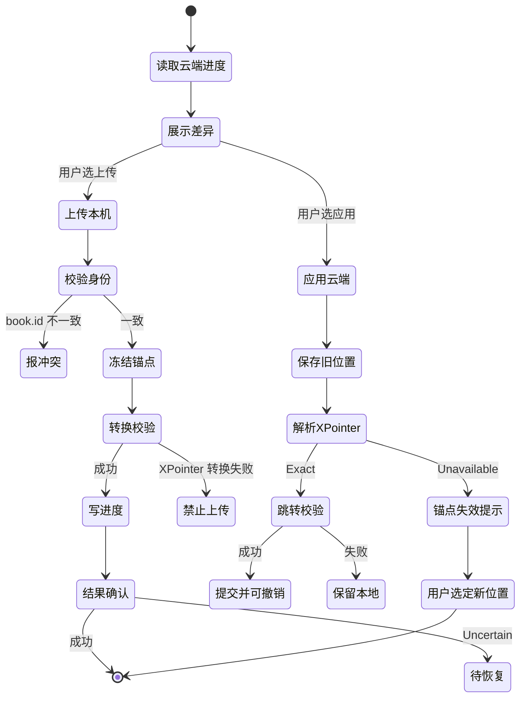

# 同步冲突模型（sync-model）

本文是 `cloud-integration.md` 的姊妹篇，聚焦**同步过程中的冲突检测、裁决与恢复**这一条主线，
把散落在技术方案 §5、§7 与 `cloud-integration.md` 里的语义收敛成可落地的模型。

> 适用范围：P4（WebDAV）与 P5（百度网盘）两后端通用。传输细节见 `cloud-integration.md`，
> 本文只讲「何时算冲突、冲突了怎么办、写入结果不确定时如何自愈」。

## 1. 总原则（一句话）

**单用户、单设备交替写入；不自动覆盖，冲突以「保留 + 提示」为主，写入结果未知时绝不报成功。**

这条原则决定了整套模型的基调：

- 没有跨设备并发保护、没有全局锁、没有向量时钟。设计上接受「同一时刻只有一个写入者」。
- 同名覆盖正文时**保留**阅读进度与封面（方案 §5.1），不因文件内容变化清空进度。
- 进度同步由**用户主动选择**「上传本机进度」或「应用云端进度」，**不按百分比/时间自动裁决覆盖**
  （方案 §5.6）。

## 2. 冲突类型与检测依据

按「冲突发生在哪一层」分为三类，各自有明确的检测信号：

| 类别 | 冲突场景 | 检测依据 | 裁决 |
| --- | --- | --- | --- |
| **身份冲突** | 云端 `progress/<bookId>.json` 的 `book.id` 与本地 `bookId` 不一致 | 读远端进度后比对 `book.id` | 报 `CONFLICT`，不覆盖，提示用户 |
| **版本冲突** | 云端进度 `schemaVersion` ≠ 2 | `ProgressRecords.decode` 校验 | 报 `UNSUPPORTED`，不覆盖 |
| **锚点失效** | 同名覆盖后，新正文结构无法解析旧 XPointer | `PositionCodec.resolveXPointer` 返回 `Unavailable` | 保留旧进度，提示「进度已保留，当前版本无法精准定位」，由用户选定新位置 |

> 关键：**不按 `percent` 大小、`updatedAt` 先后、`revision` 高低自动判定「哪端更新」**。
> `revision` 仅用于写入时递增（读远端 revision 再 +1），`percent` 仅用于显示，
> `updatedAt` 用显式偏移但**不**作为覆盖裁决依据（方案 §5）。

## 3. 写入结果确定性（failed vs uncertain）

这是数据能否与 KOReader 互通的关键语义，已在 `CloudError.kt` 用 `Outcome` 落地：

| 结果 | 含义 | 允许的动作 |
| --- | --- | --- |
| `Failed` | 请求未发出或明确失败 | 可安全重试 |
| `Uncertain` | 写入可能已在远端生效，但结果未确认 | **禁止直接重试写入**，先重新查询远端状态 |

映射规则（对齐插件 `errors.lua`）：

- 网络超时、连接中断、HTTP 5xx 后无法确认是否落盘 → `Uncertain`。
- 明确的 4xx 业务错误（如 404、409、授权失败）→ `Failed`。

**约束**：任何写路径（上传书、上传进度、删除）在 `Uncertain` 时都**不能**向用户报「已同步成功」，
必须提示「结果未知，请稍后重新查询」。

## 4. 待发布恢复（publication_recovery 等价物）

正文上传成功但列表发布失败的场景，需要「待发布记录」保证最终一致：

```
正文已上传 ── 列表发布失败（Uncertain）──> 记录待发布 <bookId>
                                          │
                                          └── 下次「补全书库列表」时重试发布
                                              （不重传正文，仅补列表条目）
```

恢复要点：

- 待发布记录只存 `bookId` + 关键元数据，**不存正文**；重试时只做列表条目写入。
- 恢复成功后清除记录；恢复失败保留记录，下次再试。
- 记录按后端隔离（用 `backendId` 区分），避免 WebDAV 与百度的待发布记录串号。

## 5. 进度同步交互（无自动覆盖）

对齐方案 §5.6，进度同步是**显式两步**，不静默合并：

```text
读取最新云端进度
   ├─ 展示：当前后端 / 本机位置 / 云端位置 / 设备 / 时间
   ├─ 用户选「上传本机进度」→ 冻结锚点 → 转换校验 → revision+1 → 写入
   └─ 用户选「应用云端进度」→ 保存本机旧位置 → 解析 XPointer → 跳转 → 校验 → 提交（可撤销）
```

失败处理：

- 网络失败 / 转换失败 / 书籍已切换 → **不提交成功**，原本地位置可恢复。
- 应用云端位置前先**暂停朗读并作废旧句子计划**，避免旧 TTS 回调把新位置改回去（方案 §5.6）。
- 从朗读切到云端位置时，云端锚点只取「已实际确认的当前朗读点」，不用「已排队未播出」的下一句。

## 6. 冲突解决状态机

下图是把「进度同步 + 锚点失效 + 待发布恢复」串起来的整体流程：

（见文末状态图，亦可用 Mermaid 描述）



## 7. 与代码的对应关系

| 本文概念 | 落地位置 |
| --- | --- |
| 错误分类 / failed-vs-uncertain | `core/cloud/CloudError.kt`（`ErrorCode` / `Outcome` / `CloudException`） |
| 后端抽象（隔离待发布记录） | `core/cloud/CloudBackend.kt`（`backendId`） |
| 编排不变量 | `core/cloud/CloudService.kt`（`index` / `uploadBook` / `uploadProgress` / `deleteBook`） |
| 身份冲突 / 版本冲突 | `core/protocol/ProgressRecord.kt`（`decode` 校验 `book.id`、`schemaVersion`） |
| 锚点失效 | `core/position/PositionCodec.kt`（`Resolution.Unavailable`） |
| 同名覆盖保留进度/封面 | `CloudService.uploadBook`（保留 `coverPath`/`coverVersion`） |
| 待发布恢复 | 待实现（首版可在 `CloudService` 内加内存/持久化队列） |

## 8. 待实现清单

- [ ] 待发布记录持久化（对齐插件 `publication_recovery`），按 `backendId` 隔离。
- [ ] 进度同步 UI 的两步交互（上传 / 应用），与「不自动覆盖」原则对齐。
- [ ] 应用云端位置前暂停朗读、作废旧句子计划的串联（衔接 P2 状态机 `invalidate()`）。
