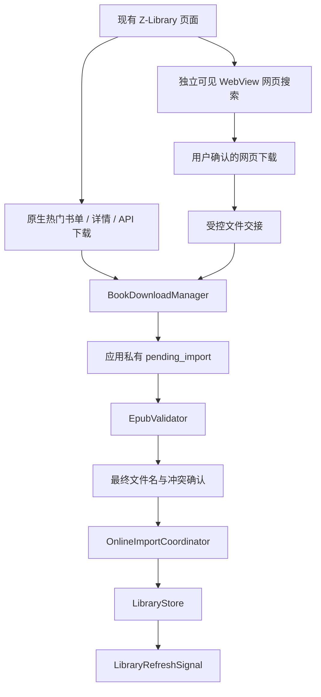

# 静读 Z-Library WebView 搜索与原生下载混合架构技术改造方案

- 版本：1.0
- 日期：2026-11-25
- 实施对象：Codex / 静读 Android 项目
- 性质：正式业务改造；先在静读测试版验收，再决定正式发布。

## 1. 背景与证据

实施前阅读仓库中的三份报告：`WebView可行性验证报告.md`、`WebView第二阶段可行性验证报告.md`、`Z-Library第三阶段API验证及正式集成建议.md`，以及在线书库统一化、服务器候选管理的既有方案。若路径不同，按文件名查找。以实际源码为准，不把本文建议的接口名当作已存在的代码。

| 能力 | 已验证结果 | 限制 |
|---|---|---|
| 原生搜索 | Access denied | 保留原实现，不自动反复请求 |
| WebView 搜索 | 两域名正常；20/20 次搜索成功，首屏中位 1068ms | 单设备、有限轮次，不代表长期 SLA |
| 网页分页 | 匿名第2、3页有结果，第4–11页为空；登录后第4页有结果 | 不写死分页上限；空页可能仍有书卡 |
| 网页登录 | 手动登录、重启恢复、退出及两域会话隔离通过 | 不代表 API 会话共享 |
| 网页下载 | HTTPS 下载回调，211708 字节 EPUB，校验通过 | 文件名 redirection.epub；正式入库未测 |
| 原生 API | 登录1991ms、额度466ms、详情540ms、取链554ms、下载3617ms、校验23ms | 单主站、单账号、单授权样本；首次扣额未测 |
| 标识对应 | 公开书单明确提供一个网页标识与 API id:hash 的对应 | 不证明任意网页结果均可映射 |
| 内存 | 网页宿主与渲染器 PSS 合计约398MiB，destroy 后约271MiB | 含进程基线；并发朗读峰值及长期泄漏未测 |

首次网页访问可能出现 HTTP 503 验证页，标准 WebView 由网站自身脚本正常完成验证；第二阶段真实内容可见约6.7秒，整页完成约30秒。不得将首次503或 onPageFinished 单独作为成功/失败依据。

## 2. 产品范围及不可变约束

1. 保留书架、云端两个底部导航；云端内百度网盘、WebDAV、Z-Library 的现有布局不重构。
2. Z-Library 原生热门书单、详情、登录、额度、下载保留。增加显式“网页搜索”入口，默认引导用户使用正常可见网页交互；不将热门书单冒充搜索结果。
3. 原生搜索实现保留，接口恢复后可重新启用；当前拒绝状态应明确提示，不自动切换服务器或循环重试。
4. 网页搜索、筛选、分页、详情、登录由网站自身完成。首版不实现隐藏 WebView、自动 DOM 抽取搜索结果、网页转原生列表、凭证注入、挑战规避或未经许可的程序化访问。仅在获得明确许可后另立需求。
5. 原生 API 仅处理服务明确提供 API 标识的资源；不猜测、推导或批量遍历书单建立标识映射。网页资源默认走网页正常下载。
6. 两种下载统一进入现有任务、校验、导入、书架刷新流程。仅处理用户有权下载的 EPUB。
7. 书库唯一性仅为规范化后的完整文件名（含扩展名）；同名只允许覆盖或取消。不提供保留两份、自动加后缀、基于哈希/标题/远程 ID 去重。文件命名确认发生在冲突判断之前。
8. 覆盖保留现有 bookId、进度、书签、云端映射；刷新正文相关元数据、封面和缓存。不得自动覆盖云端正文；进度位置失效时沿用现有兼容处理，不承诺不同版本 EPUB 的 CFI 一定有效。
9. 不修改现有搜索偏好、服务器配置交互、百度网盘/WebDAV 同步、Foliate.js 阅读器、Kokoro/Sherpa-ONNX 和系统 TTS 的业务行为。必要的进程初始化防护须最小化。
10. 保持静读测试版独立 applicationId、签名及数据目录；不得覆盖用户正式安装版。正式包不含三阶段探针及其导出入口。

## 3. 总体架构



主进程独占任务数据库、正式书库登记、文件替换和同步写入；网页进程只维护网页 UI、网页会话及下载交接。不得跨进程直接读写同一 library.json 或以普通单例假设共享状态。

## 4. 源码审计与实施前检查（阶段 A）

先定位 `ZLibraryApi`、`ZLibraryBookProvider`、`ZLibraryConfigStore`、`CatalogBookProvider`、`BookDownloadManager`、`OnlineDownloadRepository`、`OnlineDownloadTask`、`DownloadManagerScreen`、`EpubValidator`、`EpubImportFiles`、`OnlineImportCoordinator`、`LibraryStore`、`LibraryRefreshSignal`、Application 初始化、Manifest、构建变体及测试目录。

输出实际文件路径、现有方法签名、任务状态、持久化字段、事务/回滚机制、minSdk、进程初始化顺序、已有冲突确认及阅读占用保护。检查当前工作树，不覆盖用户未提交修改。建立现有单测和构建基线。报告中的类名为已观察到的模块，以下新接口均为建议，按项目风格适配。

## 5. UI 与导航（阶段 D）

- Z-Library 页面保留现有热门书单及设置入口；增加清晰的网页搜索按钮。原生搜索拒绝时展示“原生搜索暂不可用，可使用网页搜索”，不得显示虚假搜索结果。
- 网页页使用独立 Activity，顶部提供返回、当前站点、刷新、关闭及必要的浏览器返回；网页区域完整可见，保留站点登录、搜索和筛选控件，不注入 CSS 隐藏网站功能。
- 系统返回键优先返回网页历史，历史为空则退出 Activity；关闭直接退出。旋转、后台恢复不重复提交搜索或下载。
- 下载确认显示文件候选名、已知大小、来源；完成后可进入现有下载任务页。命名/覆盖确认在主进程 UI 中处理，后台任务不得自动弹出 Activity 或自动覆盖。
- 服务器设置与搜索偏好保持原样。网页模式使用现有选定服务器；网站自己的筛选与原生搜索偏好独立，不宣称自动同步。

## 6. WebView 容器与进程（阶段 C）

建议 `ZLibraryWebActivity` 使用非导出独立进程 `:zlibraryweb`（名称可调整）。Android 9/API28 及以上，在该进程任何 WebView/CookieManager 初始化之前设置专属 `WebView.setDataDirectorySuffix`。检查 Application、ContentProvider、AndroidX Startup 等是否提前初始化 WebView；避免网页进程启动数据库写入、同步任务、阅读器或 Kokoro。低于 API28 若无法安全隔离，首版关闭内置网页入口并提供外部浏览器正常访问，不冒险共享数据目录。

WebSettings：默认 UA、JavaScript 与 DOM Storage 开启、默认 TLS 校验、禁止 mixed content、关闭 file access 与不必要的 content access；不开放通用 JS bridge，不允许网页访问应用文件或任意调用原生接口。SSL 错误取消，禁止 proceed。正式版关闭 WebView 调试；日志不得包含 Cookie、密码、签名链接、完整敏感 URL。

导航：仅允许正常 HTTPS 站点导航；对非预期外部域名显示确认或交由系统浏览器，不向外部域传递认证信息。下载 CDN 与页面域分开验证，不把任意重定向目标当作可信 API 服务器。拒绝 file/content/javascript 等危险导航；外部 Intent 仅通过明确白名单和用户操作处理。

会话：网页 Cookie 由独立 WebView 数据目录管理，必要时 flush；不读取或注入原生 API 凭证，不将网页 Cookie 写入任务表。切换域名不复制 Cookie。退出网页账号使用网站自身流程；关闭页面不等于退出登录。

### 6.1 页面状态

建议状态：Idle、Loading、VerificationOrWaiting、ContentVisible、NetworkError、Timeout、RendererGone。使用导航代次标识避免旧回调覆盖新状态；主文档错误与子资源错误分开。首次503时允许正常网页继续显示和运行，不自行解决验证；真实内容可见后撤去阻塞 Loading。不能仅凭书卡数量判定成功，也不能因统计脚本拖尾持续遮挡页面。必要时仅使用非敏感页面状态观察，不抽取搜索书目。

建议首版导航等待上限30秒（可配置的工程默认值，不是实测 SLA），超时提供继续等待/手动重试/关闭；明确网络错误可提前展示。不得自动高频刷新。处理同 URL 重载、正常重定向及网页内导航。onRenderProcessGone 后移除并销毁旧实例，用户主动重试时重建。

## 7. 统一下载入口与持久化（阶段 B）

### 7.1 接口建议

```kotlin
// 示意签名，按实际项目类型适配；不要求照搬。
data class ExternalDownloadReceipt(
    val transferId: String,
    val source: String,
    val contentUri: Uri,
    val expectedBytes: Long?,
    val suggestedName: String?,
    val remoteRef: String?,
    val accountScope: String?
)
// 主进程负责有界复制、任务登记及恢复。
suspend fun acceptCompletedDownload(receipt: ExternalDownloadReceipt): TaskId
```

网页来源标识建议 `ZLIBRARY_WEB`，与原生 API 来源区分；不要伪造 API id:hash。账号作用域只存必要的非秘密标识；无法可靠取得则显式未知，不猜测账号，不写入错误云端映射。

跨进程使用非导出显式组件、受限 ContentProvider/FileProvider 或 Binder 等现有适用机制；优先复用项目已有 IPC。只传受控 URI 和小型元数据，不传整本 EPUB 字节数组。主进程核验调用方、任务归属、URI authority、路径边界、大小上限和实际可读性。不得接受任意绝对路径或公开可写导入接口。

### 7.2 任务生命周期

```text
CREATED -> DOWNLOADING -> STAGING -> VALIDATING
        -> AWAITING_NAME (必要时) -> AWAITING_OVERWRITE (同名时)
        -> IMPORTING -> COMPLETED
任意可失败阶段 -> FAILED（记录失败阶段及可重试性）
用户取消 -> CANCELLED
```

上述为逻辑状态，优先映射现有枚举，只有确实缺失时才新增。现有 `run` 在检查 pending 前解析 Provider 的行为需调整：已有有效 pending 时直接进入校验/导入；仅原生网络任务且无 pending 时解析 Provider。外部任务缺少 pending 时提示重新选择文件或重新由用户发起网页下载，禁止自动重复取链。

### 7.3 文件与任务一致性

1. 使用稳定 transferId 幂等接收；下载开始时登记系统下载 ID 与任务关联（若采用系统 DownloadManager）。任务数据库仍由主进程写入。
2. 在应用私有目录按 taskId 创建 `.part`，有界流式复制，检查实际字节数与可信预期大小；关闭流后同文件系统原子改名至 pending 路径。
3. 文件系统和数据库不是同一事务：使用可恢复中间状态及启动对账。任务登记失败不得留下不可追踪文件；进程在任一步骤死亡后应能识别 pending 或清理孤儿文件。
4. 重复回调不得创建第二条任务或重复导入；任务状态更新采用现有事务或互斥机制。
5. 重启恢复不应无条件删除外部任务的有效 pending；对账确认归属和完整性后恢复待确认/失败状态。导入失败保留可用 pending，成功或明确取消后清理。
6. 保留原有 `online_download_task` 与 `online_book_mapping` 设计；先审计现有字段，必要时做最小兼容迁移（如来源、外部下载 ID、阶段、pending 路径），不另建重复任务体系。迁移须测试旧数据、失败回滚与升级，禁止 destructive migration。

## 8. 网页下载接入（阶段 D）

首版仅支持第二阶段已验证的用户主动触发、HTTPS GET 文件交付。使用 DownloadListener 接收事件，用户确认后使用 Android DownloadManager 或项目已有安全传输实现。不要把 MIME 或扩展名当作最终可信依据。对于 POST、Blob、依赖网页认证的交付，若无站点明确支持的正常交付方式，提示暂不支持或让用户通过浏览器下载后手动导入，不实现绕过机制。

下载目标为受控暂存位置，不直接写正式书架。系统下载完成后主进程通过已记录的 download ID 查询状态及 URI；不信任单独广播，校验任务归属、成功状态、文件大小及内容。处理重复广播、进程死亡、取消、失败、磁盘不足、权限失效及重启后查询。下载 URL 可能过期，不持久化签名链接；失败重试优先使用有效 pending，否则由用户重新发起。不得自动转发 Cookie 或认证头至 CDN。

## 9. EPUB 校验、命名与覆盖（阶段 B/D）

复用 `EpubValidator`、`EpubImportFiles` 和 `OnlineImportCoordinator`。检查 ZIP 结构、mimetype、container.xml、OPF 路径、解压限额及已有安全约束；拒绝 HTML 错误页、损坏 ZIP、非 EPUB、路径穿越及超限文件。必要时核对可信长度或摘要；SHA-256 不参与书库去重。

命名优先级：可辨认的服务端文件名；若为 redirection.epub、download.epub 等占位名，优先使用已校验 EPUB 的 OPF 标题；仍不可用时使用用户确认的名称。允许在最终冲突判断前编辑候选名；规范化非法字符、保留名、长度、空名及扩展名。不得自动追加序号。最终完整文件名是唯一键。

同名处理：只显示覆盖/取消；覆盖授权绑定当前目标版本，提交前复查冲突及阅读占用。相同文件名的导入提交串行化。先完成校验和新正文暂存，再使用既有安全替换及回滚机制；禁止先删除旧正文。失败时旧书可继续打开，书库记录与正文保持一致。保留 bookId、进度、书签和云端映射；刷新封面、目录、元数据及缓存。取消不改变旧书。远端 ID 仅定位来源，不能替代文件名唯一性。

## 10. 原生 API 兼容（阶段 E）

保留原生热门书单、账号、额度、详情、下载及现有登录回退流程。搜索 Access denied 单独分类，不视为服务器故障、不自动触发域名轮换。只有服务明确提供 id:hash 时调用对应 API；网页标识与 API 标识分开存储，首版不实现跨通道自动映射。

修正第三阶段发现的格式字段兼容：同时考虑 `extension` 与 `format`，明确缺失、冲突或不支持格式的状态，不再无条件默认为 EPUB；保持既有其他来源映射行为。补充单测。HTTP 200 不等于业务成功，继续校验业务响应。额度查询失败不伪造额度；本轮重复下载未扣额不代表首次下载免费。用户确认后才取链，不进行自动重复取链测试。

## 11. 内存与生命周期（阶段 F）

按需启动单个网页 WebView，不预热，不为每个域创建实例。页面不可见时停止非必要工作；永久退出时停止加载、移除视图、解除回调并 destroy；保留最小导航信息及持久 Cookie，不承诺冷启动恢复完整历史。处理渲染器崩溃。不要调用影响其他 WebView 的全局 pauseTimers，也不要因打开网页而停止用户正在进行的朗读。

独立进程不等于降低整机内存。保持现有 Kokoro 模型槽位、内存守卫及系统 TTS 回退，不重构语音服务。Android 14+ 不依赖已不分发的旧低内存回调；使用适用生命周期事件与现有加载前守卫。记录网页宿主、阅读器/语音宿主、Chromium 渲染器 PSS、availMem、模型加载耗时和回退结果。测试重复进入退出、低内存设备、锁屏朗读、网页渲染器终止；不得仅以一次 destroy 后内存下降证明无泄漏。若发现阅读器自身释放问题，单独报告，不擅自扩大本次范围。

## 12. 失败处理矩阵

| 情况 | 行为 |
|---|---|
| 原生搜索拒绝 | 明确提示，保留网页入口，不自动重试/切站 |
| 网页验证页 | 正常展示并等待网站自身流程；超时可手动重试 |
| SSL 错误 | 取消并提示，不忽略证书 |
| 空结果 | 由网站显示，不作为网络错误 |
| 登录失效 | 用户在对应通道正常登录，不共享凭证 |
| 不支持下载类型 | 提示使用正常浏览器下载及手动导入 |
| 下载中断/磁盘不足 | 记录失败，不写正式书架 |
| EPUB 校验失败 | 禁止导入，提示原因，清理无效暂存 |
| 同名或阅读占用 | 覆盖/取消或等待解除占用，禁止静默替换 |
| 导入失败 | 保留有效 pending，允许重试，不重复消耗下载额度 |
| 进程死亡 | 启动对账，恢复任务或提示重新选择文件 |
| 渲染器崩溃 | 销毁实例，允许用户重开，不影响书库及朗读 |

## 13. 开发阶段与交付门槛

| 阶段 | 内容 | 通过条件 |
|---|---|---|
| A | 源码审计、基线 | 输出实际改造清单及基线结果 |
| B | 外部文件接收、任务恢复、命名覆盖 | 使用本地合法 EPUB 夹具完成入库、冲突、失败及重启测试 |
| C | 独立 WebView 容器 | 真机搜索、筛选、登录、返回、错误及会话测试 |
| D | 网页下载与 UI 集成 | 真机用户授权下载进入统一任务并成功入库 |
| E | 原生 API 兼容及回归 | 既有 API 单测及授权样本回归，格式字段测试 |
| F | 生命周期与内存 | 并发朗读、反复打开关闭、渲染器故障及低内存测试 |
| G | 全量回归及发布检查 | 测试版安装、正式构建、探针隔离及验收报告 |

阶段顺序 A→B→C→D→E→F→G。每阶段先检查实际代码再实施，完成后运行相关单测、lint、测试版构建；失败先修复，不带已知回归进入下一阶段。建议首次仅执行 A，提交审计结果后由用户确认 B–G 的具体改造范围。不得声称未执行的真机测试通过。

## 14. 测试与验收

### 单元及集成测试

- 原生 API 登录回退、权限拒绝、额度、extension/format 映射及未知格式。
- 外部任务幂等、重复完成事件、URI 边界、超限复制、长度不符、损坏 EPUB、非 EPUB。
- 占位文件名、非法字符、中文标题、超长/空名、同名不同内容、同名相同内容（仍需覆盖确认）。
- 覆盖取消、正在阅读、并发同名任务、覆盖中断及回滚；旧 bookId、进度、书签、映射保持。
- 下载失败、导入失败后 pending 重试、pending 丢失、孤儿文件、进程死亡与旧数据库迁移。

### 真机验收清单

- [ ] 中英文网页搜索、无结果、正常分页、筛选、详情、返回、登录退出及重启恢复。
- [ ] 主备服务器切换与会话隔离；真实断网/恢复、超时、证书错误安全处理。
- [ ] 网页授权 EPUB 下载、统一任务展示、命名、入库、打开阅读及进度记录。
- [ ] 同名仅覆盖/取消；覆盖失败旧书完整；取消无副作用；不自动覆盖云端。
- [ ] 系统下载完成后进程死亡恢复；重复回调不重复入库；失败重试不重复取链。
- [ ] 原生热门书单、详情、账号、额度、下载正常；搜索拒绝不误判服务器故障。
- [ ] 网页与阅读器、Kokoro、系统 TTS 并发及锁屏朗读；反复退出无持续增长证据（记录多轮 PSS）。
- [ ] 百度网盘、WebDAV、既有搜索偏好、服务器设置、书架及同步回归通过。
- [ ] 测试版独立安装；正式 APK 无三阶段探针、无调试导出入口、无敏感日志。

### 构建命令（按实际仓库核实）

```bash
./build-local.sh test :app:lintTtsTestDebug
./build-local.sh :app:assembleTtsTestDebug
./build-local.sh :app:assembleProductionRelease
```

仅在用户同意且设备可用时覆盖安装测试版；核对 applicationId 与签名，禁止安装覆盖正式版。记录 lint 新增警告与基线差异；既有报告第三阶段为0错误、53警告、3提示，不能将既有警告冒充本次新增问题。正式包检查 Manifest 和 DEX。

## 15. Codex 执行与汇报要求

每阶段汇报：实际修改文件、实现方式、与本文差异、数据库迁移、测试命令及真实结果、未测项目、风险和下一步。最终输出 `Z-Library混合架构正式集成验收报告.md`，包含真机日志摘要（脱敏）、内存数据、任务恢复证据、构建产物及未解决事项。不得提交账号密码、Cookie、签名链接、测试书籍正文或敏感日志。未经用户要求不提交 Git、不发布 APK、不修改其他功能。

## 16. 非目标及待确认事项

- 任意网页标识与 API 标识的映射尚未证实，不阻塞网页下载路线。
- 正式入库、真实断网期间错误表现、低内存设备及并发峰值尚未验证，属于实施验收项。
- 首次下载扣额行为、长期站点可用性及程序化访问许可未确认；不承诺搜索 API 恢复时间。
- 本文基于三份验证报告而非直接审计源码；IPC 类型、状态枚举、数据库字段、超时默认值及低版本兼容方案属于设计建议，阶段 A 核实后再定稿。
- 本次不实现其他书源、隐藏网页抓取、自动标识匹配、阅读器/TTS 重构或新的去重策略。
