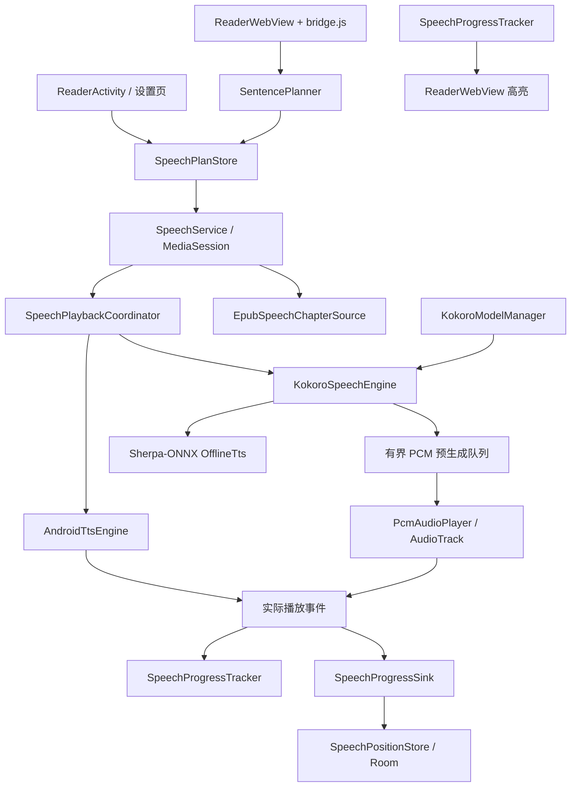

# 内置 Sherpa-ONNX 运行时 + 用户导入 Kokoro 模型 离线 TTS 技术改造方案（v3.3）

版本：3.3  
日期：2026-11-23  
状态：实施基线（在 v3.2 基础上增加独立测试版构建与安装隔离；**本版不涉及代码改动**）  
基线：v1.0 原方案 + v2.0 修订稿 + 第二轮工程核对结论  
目标机型：三星 Galaxy S25+（arm64、12 GB RAM、Android 15/16）

> 标题口径：**运行时内置，模型由用户导入**。APK 不打包 Kokoro 权重，避免安装体积增加约 350 MB 与许可再分发问题。

---

## 0. 修订摘要

### 0.1 v2.0 → v3.0 的关键变化

| 主题 | v2.0 | v3.0 修订 |
|---|---|---|
| 进度落库归属 | 写作「服务写入、Activity 收集」 | **纠正**：`SpeechProgressTracker` 由服务写入，但 Room 落库实际在 `ReaderActivity` 的收集协程里；Activity 销毁即停止持久化。改为在 `:core` 增加持久化端口，由服务主动写 |
| 分段索引稳定性 | 未讨论 | 新增：`requestChapterText(currentCfi)` 使片段 0 从当前阅读位置开始，`segmentIndex` 跨次恢复会漂移；需改为「整章文本 + startIndex」 |
| 状态机 | 只有 `position` | 明确 `currentSegment` 与 `lastCompletedSegment` 双状态；现有 `confirmedSegmentIndex` 命名具有误导性 |
| int8 / fp32 | 默认 int8 | 按产品要求：**优先支持并默认 `kokoro-int8-multi-lang-v1_1`**；fp32 作为备选、对照与异常回退；int8 必须启用逐句音频健康检查 |
| SDK 版本 | 直接取 2.0.3 | 改为「先验证、后锁定」；2.0.3 发布仅 1 天，默认倾向成熟版本 1.13.4，除非其不满足 v1_1/回调需求 |
| 唤醒锁 | 实测后再定 | 决策：朗读会话期间持有 `PARTIAL_WAKE_LOCK`，暂停/停止立即释放，并纳入耗电测试 |
| 测试基础 | 未提 | 纠正：`:speech` **有 junit 依赖但无测试源码**，缺 `kotlinx-coroutines-test`；阶段 C 前补齐 |
| 模块依赖 | 未提 | 明确 `app → reader/speech`、`speech/reader → core`，`:speech` 不可直接依赖 Room |
| `fileGeneration` | size + mtime | 纠正：`LibraryStore.Entry` 只有 `size/lastReadAt`，没有文件 mtime；需在导入时记录 mtime 或内容哈希 |
| 产品决策 | 列 6 个待确认 | 本版直接拍板，仅保留 3 个需业务确认项 |


### 0.3 v3.2 工程评估补强（本版新增）

1. **CFI 精确起点**：整章稳定分段仍保留，但 `startIndex` 升级为节点索引 + 节点内字符偏移；以原始 CFI/锚点为恢复权威，`segmentIndex` 仅为加速缓存。
2. **播放边界**：单个 `AudioTrack` 的 notification marker 不可同时维护多个独立句子 marker；统一使用累计帧边界、单个活动 marker 和播放头校验，严禁将 `write()` 当作播放完成。
3. **语速唯一责任**：Kokoro 首版由模型合成 speed 参数控制；不同时修改 `AudioTrack` playback rate。切换语速失效旧 PCM 并重合成未完成句。
4. **先试音再导入器**：阶段 B 使用开发期私有目录模型，不依赖完整 SAF 导入器；正式 ZIP / tar.bz2 安全导入放到 E。
5. **服务独立启动**：进度持久化依赖由 Application 级容器构造，不得依赖 Activity 先初始化。
6. **native 生命周期**：generation 只隔离回调，不代表取消推理；串行推理、延迟释放、限制积压。
7. **实测优先**：SDK API、模型文件名、许可、INT8 与 FP32 表现均需在阶段 A/B 核验；本文的代码是设计接口，不保证与某个版本 AAR API 完全一致。

### 0.2 仍然保留的 v2 结论

- 现状是整章 `speakAll` 入队；协调器是必需项。
- 暂停不能复用 `tts.stop()`；Kokoro 必须保留 AudioTrack 帧位。
- 句级高亮为产品口径；字级高亮在 Kokoro 路径明确降级。
- 跨章高亮是既有技术债，不纳入 Kokoro 首版验收。
- 模型/音色/语速为全局偏好，默认不新增 Room 字段。

---

## 1. 目标与非目标

### 1.1 目标

1. 应用进程内运行 Sherpa-ONNX Kokoro，飞行模式可朗读，不依赖系统 TTS。
2. 保留系统 TTS 作为回退，用户可切换。
3. 复用现有 EPUB 文本准备、分句、原文偏移映射、跨章计划、高亮、媒体控制与位置恢复。
4. 支持开始/暂停/恢复/停止/上一句/下一句/语速/中文音色/后台锁屏/跨章连续播放。
5. 模型由用户通过 SAF 导入应用私有目录；APK 不内置。
6. 严格区分「合成完成」与「实际播放完成」，只依据后者推进已读游标。

### 1.2 非目标

- 不做在线 TTS、模型下载、语音克隆、训练/微调、ASR、云端音频缓存。
- 不重构 foliate-js、CFI/XPointer、百度网盘/WebDAV、书库与同步协议。
- 不要求 Root、ADB 改默认引擎、修改三星系统配置。
- 首版不承诺 Kokoro 的字级时间戳高亮与跨章 CFI 高亮。

### 1.3 已确认的产品约束

- 目标机型只有三星 Galaxy S25+ 一档：arm64、12 GB RAM、Android 15/16。
  - 优先支持 `kokoro-int8-multi-lang-v1_1`（约 140 MiB，存储与加载压力更小），作为默认模型。
  - fp32 保留为对照与异常回退，不做低端机适配分支。
  - Release 只打包 `arm64-v8a`；`x86_64` 仅用于模拟器调试。
- **跨章不要求高亮**，只要求「能继续读」：后台跨章时无高亮可接受，回到阅读界面后不强制跳章定位；优先保证不断读、不丢句、位置可恢复。
- 不采用官方 `SherpaOnnxTtsEngine` APK；模型统一通过应用内「导入资源总和压缩包」提供，阶段 B 直接做最小试音。

---

## 2. 已核实的工程现状

### 2.1 模块与依赖

- `:core`：纯 Kotlin（分句、计划、状态机、协议）。
- `:reader`：书库、EPUB 解析、Room、WebView 宿主。
- `:speech`：Android TTS 与前台服务；依赖 `:core`，**不依赖 `:reader`**。
- `:app`：同时依赖 `:reader` 与 `:speech`，负责注入与 UI。

由此决定：服务侧若要持久化位置，不能直接调用 `:reader` 的 Room DAO，必须通过 `:core` 的端口接口 + app 注入。

### 2.2 现有播放模型

- `speech/TtsEngine.kt`：直接持有 `android.speech.tts.TextToSpeech`；`speakAll()` 整章剩余片段一次性入队，首段 `QUEUE_FLUSH`、其余 `QUEUE_ADD`。
- `speech/SpeechService.kt`：`speakFrom()` 一次性入队；`onStart`/`onRangeStart` 推进进度；`onDone` 仅在本章最后一段触发跨章。
- 因此现状是「引擎内部队列驱动」，不是逐句调度。

### 2.3 控制与并发

- `SpeechService` 的协程 scope 是 `SupervisorJob() + Dispatchers.Main`；模型初始化与合成必须切到 `Default/IO`。
- `handlePause()`：`sessionId++`、`tts.stop()`、`stateMachine.pause()`；`stop()` 会清空队列，不能用于 Kokoro 暂停。
- 隔离手段目前只有 `sessionId` 字符串；Kokoro 需要 `{session, generation, segment}` 三元令牌。
- 看门狗为「2 秒静默 + `engine.isSpeaking()`」，只适用于系统引擎。

### 2.4 进度与持久化（关键纠正）

- `SpeechProgressTracker` 在 `:speech`，由服务更新；`ReaderActivity` 收集它做高亮。
- **Room 落库发生在 `ReaderActivity` 的收集协程**（`ReaderActivity` 第 507–520 行，800 ms 去抖 → `SpeechPositionStore.save`）。
- 后果：Activity 销毁后，朗读继续但不落库；直接违背「Activity 销毁后跨 3 章、被杀后可恢复」的验收项。
- 方案修正：`SpeechProgressTracker` 只负责 UI 快照；持久化改为服务侧通过 `:core` 端口主动写入（见 §9、§10）。

### 2.5 状态机现状

- `SpeechStateMachine` 只有一个 `position(segmentIndex, charOffset)`；`onStart` 回调即以 `charOffset = 0` 调用 `onProgress`。
- 属性名 `confirmedSegmentIndex` 实际返回的是「正在播的段」，不是「已播完的段」。
- 必须显式建模：
  - `currentSegment`：当前正在朗读/高亮的句；
  - `lastCompletedSegment`：实际播放完成的最后一句（用于跨章与完成语义）。

### 2.6 文本与锚点

- 当前章：`bridge.js` 的 `chapterText` 事件返回 `{ cfi, text }` 节点，锚点为 CFI。
- 后续章：`EpubChapterTextSource` 生成 `"章节:段落"` 形式锚点。
- `ReaderActivity` 只对以 `epubcfi(` 开头的 `sourceAnchor.nodeId` 调用高亮。
- `requestChapterText(currentCfi)` 从**当前阅读位置**开始提取，返回事件只有 `index`；因此片段索引的基准随起点变化。
  - 风险：保存的 `segmentIndex` 只在同一文本起点下有效。若用户阅读位置变化后恢复，`restored.chapterIndex` 匹配但索引已漂移。

### 2.7 配置与数据

- `ReaderSettings` 仅有 `speechRate`、`speechVoice`。
- `SpeechConfig(rate, voiceName)` 无法表达引擎/模型/Kokoro speaker。
- `speech_position` 字段：`bookId/fileGeneration/chapterIndex/segmentIndex/charOffset/savedAt`；`AppDatabase.version = 4`。
- `fileGeneration` 恒为 `""`。
- `LibraryStore.Entry` 只有 `size`、`lastReadAt`，**没有文件 mtime**；不能用 `lastReadAt` 代替文件代次。

### 2.8 构建与测试

- Gradle 9.7.0（腾讯镜像）、AGP 9.3.1、Kotlin 2.4.20、compileSdk 37 / targetSdk 36 / minSdk 26。
- `settings.gradle.kts` 使用 `FAIL_ON_PROJECT_REPOS`，仓库集中管理；新增 JitPack 需改 settings，成本高于本地 AAR。
- 本机 shell 无 `java`，Android Studio JBR 可用；未安装 NDK，走 AAR 不需要 NDK。
- `:speech` 有 `testImplementation(libs.junit)`，但**没有任何测试源码**，也没有 `kotlinx-coroutines-test`。

---

## 3. SDK、版本与模型

### 3.1 运行时分发与版本策略

| 项 | 结论 |
|---|---|
| 引入方式 | AAR 放入 `speech/libs/`，用 `implementation(files(...))`；避免修改 settings 的仓库策略；锁定 SHA-256 |
| 备选 | 从 JitPack 下载固定版本 AAR 后同样落地为本地文件，而不是直接依赖远程仓库 |
| NDK | 不需要；只有裁剪算子/自编译才需要 |
| ABI | Release 仅 `arm64-v8a`；Debug 追加 `x86_64`；放弃 32 位 |
| 版本候选 | 1.13.4（成熟、问题已知）与 2.0.3（2026-11-22 发布，仅 1 天） |
| 默认决策 | **阶段 A 同时验证两者；默认倾向 1.13.4**。仅当 1.13.4 不满足 v1_1 模型或流式回调需求时，改用 2.0.3 |

阶段 A 必须确认：AAR 内 ABI、`classes.jar` 中的 TTS 类与 `loadLibrary` 名称、minSdk、16 KB page size 对齐、`generateWith...` 方法签名与回调线程、取消语义。

不采用官方 `SherpaOnnxTtsEngine` APK（独立 App 方案）；阶段 B 直接在应用内完成最小试音。

### 3.2 模型事实（kokoro-multi-lang-v1_1）

- 采样率 24 kHz，单声道 Float32。
- speaker 共 103 个：
  - `af` 0–1、`bf` 2（英文）；
  - `zf` 3–57（55 个中文女声）；
  - `zm` 58–102（45 个中文男声）。
- 必需文件：`model.onnx`、`voices.bin`、`tokens.txt`、`espeak-ng-data/`、`lexicon-us-en.txt`、`lexicon-zh.txt`。
- 模型包（按优先级）：
  - **首选 `kokoro-int8-multi-lang-v1_1`，约 140.2 MiB**；
  - 对照/回退 `kokoro-multi-lang-v1_1`（fp32），约 348 MiB；
  - 解压后体积更大，导入前按实际值检查存储。
- 同系列 v1_0 的 `model.onnx` 约 310 MB、`voices.bin` 约 26 MB；第三方应用安装后约 382 MiB。
- 运行时内存预估 200–400 MB 级，必须真机实测；与 WebView 并存时仍需观察峰值。

### 3.3 int8 优先与 fp32 回退（决策）

- 产品要求：**优先支持 `kokoro-int8-multi-lang-v1_1`**，它是默认导入与推荐模型。
- 已知风险来自 `sherpa-onnx` issue #3754（1.13.4 + **v1_0** int8 + Pixel 10 Pro / Android 16）：
  - int8 输出偶发**整句样本钉在 ±1.0**（爆音后静音），与引擎历史状态相关；
  - x86_64 与 fp32 同条件无法复现；
  - int8 在 ARM 上 RTF ≈ 0.62，**慢于 fp32 的 0.48–0.51**；
  - int8 输出在 `sampleRate/5`、`2·sampleRate/5` 有稳态杂音。
- 该报告针对 v1_0；v1_1 是否修复必须由阶段 B 实测确认，因此：
  1. **默认 int8 v1_1**，但强制启用 §6 逐句音频健康检查（钉死/空音频/NaN）；
  2. 同时提供 fp32 模型导入与一键回退；
  3. 若 int8 v1_1 在 S25+ 上复现上述异常，或明显慢于 fp32，则把推荐模型切换为 fp32，并保留 int8 作为「省空间实验选项」；
  4. 两者都不可用时才回退系统 TTS。

### 3.4 许可与合规

- Sherpa-ONNX runtime：Apache-2.0。
- Kokoro-82M-v1.1-zh 模型卡：Apache-2.0（以发布页为准）。
- `espeak-ng-data` 属 GPLv3 谱系数据：不内置 APK、仅用户导入时风险较低；若未来分发模型包需法务确认。
- 更新 `docs/third-party-notices.md`：AAR 版本与 SHA-256、模型来源、许可证、音色归属；若引入 Commons Compress 需补充 Apache-2.0 声明。

### 3.5 未实测项（阶段 A/B 门槛）

- [ ] ABI 列表、16 KB 对齐、minSdk、TTS 类与 JNI 名称。
- [ ] 与 AGP 9.3.1 / Gradle 9.7 / Kotlin 2.4.20 的解析与打包结果。
- [ ] 1.13.4 与 2.0.3 对 v1_1 模型、流式回调、取消的实际支持。
- [ ] fp32/int8 的目标机音质、RTF、内存、发热。
- [ ] 模型包内各文件 SHA-256 与官方值。

---

## 4. 目标架构



### 4.1 职责边界

- `SpeechService`：会话、音频焦点、前台、媒体通知、调度入口；持有持久化端口。
- `SpeechPlaybackCoordinator`：统一控制语义、事件、代次失效、预取与切章。
- `AndroidTtsEngine`：现有 `TtsEngine` 改名并适配统一接口。
- `KokoroSpeechEngine`：模型初始化/释放、逐句合成、音色与语速映射、音频健康检查。
- `PcmAudioPlayer`：AudioTrack 播放、暂停/恢复、完成判定、错误映射。
- `SpeechProgressSink`（`:core`）：位置持久化端口，服务调用，app 注入实现。
- `KokoroModelManager`：导入、校验、切换、删除保护。
- `EpubSpeechChapterSource`：保持后台独立解析。

---

## 5. 统一接口与事件语义

```kotlin
interface SpeechPlaybackBackend {
    val type: SpeechEngineType
    suspend fun prepare(config: SpeechEngineConfig): PrepareResult
    suspend fun play(plan: SpeechPlan, fromIndex: Int, token: SessionToken)
    suspend fun pause()
    suspend fun resume()
    suspend fun stop()
    suspend fun release()
    val events: Flow<SpeechPlaybackEvent>
}

data class SessionToken(val sessionId: Long, val generation: Long)

sealed interface SpeechPlaybackEvent {
    val token: SessionToken
    data class SegmentStarted(override val token: SessionToken, val index: Int) : SpeechPlaybackEvent
    data class SegmentCompleted(override val token: SessionToken, val index: Int) : SpeechPlaybackEvent
    data class Buffering(override val token: SessionToken, val index: Int) : SpeechPlaybackEvent
    data class Failed(override val token: SessionToken, val reason: String) : SpeechPlaybackEvent
}
```

### 5.1 事件与进度契约

- `SegmentStarted(N)`：高亮第 N 句（整句）、记录 `currentSegment = N`、保存「当前句起点」；**不得标记完成**。
- `SegmentCompleted(N)`：仅当第 N 句 PCM 实际播放完且 token 有效时发出；更新 `lastCompletedSegment = N`；随后准备 N+1 或跨章。
- `charOffset`：
  - 系统 TTS：沿用 `onRangeStart` 字级偏移；
  - Kokoro：恒为 0，表示句起点，禁止伪造；
  - 恢复时优先用持久化的原文 CFI/稳定锚点映射到整章句子；`segmentIndex` 仅在书籍代次、章节与分段算法版本均匹配时作快速定位；字级偏移仅系统引擎使用。
- `Buffering`：MediaSession 置 `STATE_BUFFERING`，不推进游标。
- `Failed`：保留位置，停止队列，上报；不静默切换引擎。
- `SessionToken`：每次 seek、上一句/下一句、切章、切模型、停止、重启队列都递增 `generation`；旧 token 的迟到回调一律丢弃。

### 5.2 状态机改造

- 保留 `SpeechStateMachine` 现有 API 兼容系统引擎。
- 新增 `currentSegmentIndex` 与 `lastCompletedSegmentIndex` 两个只读状态。
- `advanceToNext()` 只能由 `SegmentCompleted` 驱动；`SegmentStarted` 只更新 `currentSegmentIndex`。
- 现有 `confirmedSegmentIndex` 的语义要么改名，要么在文档与测试中明确它代表「当前句」；跨章判断必须使用 `lastCompletedSegmentIndex`。

---

## 6. 播放层设计（PcmAudioPlayer）

- 格式：按 SDK 返回采样率配置（Kokoro 24 kHz），优先 `ENCODING_PCM_FLOAT`，必要时转 16-bit。
- 模式：`MODE_STREAM`；`WRITE_BLOCKING` 在后台线程；不得阻塞主线程。
- 完成判定：
  - `write()` 完成 ≠ 播放完成；
  - 采用**单 AudioTrack + 句子累计帧边界表**；任意时刻仅设置下一个尚未完成边界的 marker（该 API 只有一个活动 marker），到达后更新下一边界；
  - 辅以 `getPlaybackHeadPosition()` / `getTimestamp()` 校验播放头、32 位回绕、暂停与路由变化；marker 丢失时只能在同一代次且播放头确认越界后补发完成事件；
  - `SegmentCompleted` 必须恰好一次，且仅在播放时间线越过该句最后一帧后发出；不宣称蓝牙设备物理出声已完成。
- 暂停：`pause()` 保留帧位与缓冲，不清空；恢复用 `play()`。
- 停止/跳句：先失效代次，再 `pause → flush → stop`；必要时重建 track，保证 flush 语义。
- 缓冲耗尽：`Buffering`，不推进游标。
- 错误：write 返回值、track 状态、路由变化、焦点丢失均映射为事件，禁止误判完成。
- 音频健康检查（每句合成后、播放前）：
  - 拒绝 NaN/Inf；
  - 拒绝持续 ≥ 50 ms 的 |sample| ≥ 0.999（钉死爆音）；
  - 拒绝整句 RMS 接近 0（空音频）；
  - 失败重试一次；仍失败则 `Failed`，提示切换 fp32 或系统 TTS。
- 唤醒锁：朗读会话期间持有 `PARTIAL_WAKE_LOCK`（覆盖句间合成空档），暂停/停止/错误立即释放；设置超时防止泄漏。
- 音频焦点：沿用 `USAGE_MEDIA` + `CONTENT_TYPE_SPEECH`；焦点丢失暂停而非清空。

---

## 7. 调度与文本索引

### 7.1 稳定的分段基准与精确 CFI 起点（v3.2 修订）

- 问题：`requestChapterText(currentCfi)` 从当前阅读位置开始，`segmentIndex` 只在该起点下有效。
- 决策：`chapterText` 请求改为**返回整章文本 + `startPosition`**，其中 `startPosition` 至少包含原始 `startCfi`、`nodeIndex` 与 `charOffsetInNode`；片段一律基于整章文本生成，索引稳定。
- 朗读起点：先解析 CFI 对应文本节点与节点内偏移，再经 `charToSource` 映射定位包含该字符的片段；不得仅用 `nodeIndex` 从整段开头朗读。
- 持久化恢复：保存稳定原文锚点（如 CFI）及分段算法版本；仅当 `bookId/fileGeneration/chapterIndex/plannerVersion` 匹配时，才允许使用缓存的 `segmentIndex`。否则以锚点重新映射；锚点失效时回退章节起点并告知用户。
- `SpeechPositionStore` 的锚点扩展需核验当前 Room schema；如需新增列，应执行正式 Room 迁移并更新版本，**不能继续宣称无条件不做 4→5 迁移**。
- 兼容性：事件保留旧字段并新增 `startPosition`，对旧消费者提供适配；后台 `EpubSpeechChapterSource` 的锚点与 WebView CFI 不是同一坐标系，跨章仅承诺继续读，不得把 `chapter:para` 冒充 CFI。
- 若产品不希望整章传输，可用原文 CFI + 稳定节点标识重建计划；首版仍采用整章方案，但应限制桥接数据大小并验证长章节性能。

### 7.2 有界流水线

```text
当前句 N 播放中
   ├─ AudioTrack 播放 N 的 PCM
   └─ 推理协程准备 N+1（最多再准备 N+2）
       ↓
   实际播放完成 N（不是合成完成 N）
       ↓
   SegmentCompleted(N) → 更新 lastCompleted → 播放 N+1
```

- 推理并发默认 1；最多缓存当前句 + 后续 2 句；PCM 上限建议 24 MiB。
- 首句优先：不等整章合成。
- 合成分块：计划片段仍按 256 字上限；送引擎时可二次切到 60–120 字，以降低首声延迟与长句阻塞（不改变原文锚点与句级高亮）。多个合成块必须聚合到原始句子的唯一完成事件；不得提前推进。
- 缓存同时限制句数（当前 + 2）、PCM 总字节数（初值 24 MiB）和音频时长；缓存满时暂停预合成，不得阻塞 AudioTrack 写线程。
- 跨章：仅在 `SegmentCompleted(本章最后一句)` 时触发，复用 `prefetchNextChapter()`。

### 7.3 控制语义矩阵

| 操作 | Kokoro 语义 |
|---|---|
| 暂停 | 暂停 AudioTrack，保留 PCM/帧位；不发 Completed |
| 恢复 | 从帧位继续；track 已释放则重播当前句 |
| 下一句 | 失效代次、丢弃余音、定位下一句、重建队列 |
| 上一句 | 同上；首句按章节规则处理 |
| 停止 | 清空队列、释放音频、持久化当前未完成句起点 |
| 切音色/模型 | 暂停、失效旧队列、重合成当前未完成句 |
| 切章/应用云端进度 | 暂停、作废旧计划与旧回调、按整章基准重建 |


### 7.5 语速控制的唯一责任层（v3.2）

- **首版选定合成层控制**：在 `KokoroSpeechEngine` 使用所选 SDK/模型实际支持的 speed 参数；阶段 A 核实参数范围与是否影响音高，阶段 B 测试 0.8×、1.0×、1.2×、1.5×。
- `PcmAudioPlayer` 始终按模型输出采样率正常播放，首版不调用 `setPlaybackParams()` 叠加变速。
- 用户播放中调整语速：先暂停当前句，递增 generation，清除旧预生成 PCM，按新速度重新合成**当前未完成句**；允许重读当前句，不允许跳句。
- 系统 TTS 路径继续使用原有 `setSpeechRate()`；UI 统一速率值，但各引擎分别映射并显示实际可用范围。

### 7.6 native 推理、取消与资源释放（v3.2）

- 推理 worker 单并发，`OfflineTts` 实例的生成、切换、释放在同一串行执行域内进行；若 SDK 明确保证线程安全，后续才可优化。
- generation/token 只让过期结果**不入队、不回写**；不能假设协程 `cancel()` 能立即终止 JNI/native 计算。
- 停止或切模型时先停止接收新任务、取消排队任务，等待当前 native 调用安全返回后再释放模型；超时只报告/隔离，不在仍执行的 native 调用上强行 free。
- 重复点击上一句/下一句应合并待处理请求，最多保留一个最新 seek 意图；禁止形成无限待推理队列。
- 对已完成但过期的 PCM 立即释放引用；测试快速切书、连续切模型、服务销毁和低内存回收。

### 7.4 看门狗替换

- 合成任务超时；
- AudioTrack 播放头长时间无进展（排除正常缓冲）；
- 会话 token 一致性与服务存活；
- 播放器错误码。
- 任一异常进入 `Failed`，保留位置，不无限重试。

---

## 8. 模型管理

### 8.1 目录与索引

```text
files/tts-models/
  staging/<import-id>/
  kokoro/<model-id>/
    manifest.json
    model.onnx            # fp32 或 int8
    voices.bin
    tokens.txt
    espeak-ng-data/
    lexicon-us-en.txt
    lexicon-zh.txt
```

`manifest.json` 记录：模型 ID、显示名、精度（fp32/int8）、SDK 版本、语言、可用 speaker、文件清单/大小/SHA-256、导入时间、验证结果。

导入源是**资源总和的压缩包**：至少包含 `model.onnx`、`voices.bin`、`tokens.txt`、`espeak-ng-data/`、两份 lexicon。压缩包内允许存在单一顶层目录（例如 `kokoro-multi-lang-v1_1/`），导入时自动归一化到该目录。

### 8.2 正式导入流程（阶段 E；阶段 B 不依赖此流程）

1. SAF 选择压缩包（`.zip` 必需；`.tar.bz2` 作为官方包的兼容格式，二者用魔数识别而非扩展名）。
2. 流式复制到 staging；限制总大小、条目数、单文件大小与解压后总大小，防压缩炸弹。
3. 逐条目安全解包：
   - 拒绝路径逃逸（Zip Slip / `..` / 绝对路径）、符号链接、加密条目、超长文件名；
   - 归一化单一顶层目录；
   - `tar.bz2` 使用 Apache Commons Compress（Apache-2.0）解析，其他格式拒绝。
4. 校验必需文件、大小、SHA-256；缺失或大小异常直接失败，不进入试合成。
5. 后台线程初始化引擎，用固定中文短句试合成；校验非空、24 kHz、speaker、耗时。
6. 通过后写入 `manifest.json` 并原子切换；旧模型不自动删除；失败清理 staging。
7. 推理进行中禁止删除/切换模型文件。
8. 导入前 `StatFs` 检查可用空间（建议 ≥ 2 倍解压体积）。
9. 路径仅限私有目录；日志不记录正文与用户路径。

### 8.3 精度与设备适配

- 默认推荐 `kokoro-int8-multi-lang-v1_1`；设置页标注「已知在部分 ARM 设备可能出现杂音，应用会自动检测」。
- 同时支持导入 fp32 模型，作为对照与一键回退。
- 无论精度，均启用 §6 音频健康检查；int8 失败重试一次后仍异常，提示切换 fp32。
- 中文音色只展示 `zf_*`/`zm_*`；音色需试听后确定默认值，不在方案中写死 sid。

---

### 8.4 阶段 B 开发期模型准备（v3.2）

- 开发者先从可信官方发布源下载完整模型资源包，在电脑上核验发布来源与文件清单；通过 `adb push` 或 Android Studio 调试流程复制到应用私有目录，必要时使用 debug-only 导入入口。
- 不在 Release 中保留调试文件路径、任意目录读取权限或绕过校验开关。
- 仅做模型初始化、固定中文试音、INT8/FP32 性能对照；不需要提前完成 ZIP/tar.bz2 解析、SAF UI、原子切换和删除保护。
- 阶段 B 失败时优先调整 SDK/模型选择，而不是投入正式模型管理器开发。

---

## 9. 服务集成改造清单

| 文件/模块 | 改动 | 风险 |
|---|---|---|
| `:core` 新增 `SpeechProgressSink` | 位置持久化端口（suspend） | 低 |
| `:core` `SpeechStateMachine` | 增加 `currentSegmentIndex` / `lastCompletedSegmentIndex` | 中 |
| `speech/TtsEngine.kt` → `AndroidTtsEngine` | 适配统一接口，内部保留整章入队 | 低 |
| `speech/SpeechService.kt` | 接入协调器；`prepare()` 移出主线程；持有并调用 `SpeechProgressSink`；看门狗替换；释放 native | 高 |
| `speech/SpeechPlanStore.kt` | `SpeechConfig` 增加 engine/model/speaker；兼容旧配置 | 低 |
| `speech/SpeechProgressTracker.kt` | 增加 `engineType`；明确 `charOffset` 契约 | 低 |
| 新增 `KokoroSpeechEngine.kt` | SDK 适配、健康检查、错误映射 | 中 |
| 新增 `PcmAudioPlayer.kt` | AudioTrack 播放与完成判定 | 高 |
| 新增 `SpeechPlaybackCoordinator.kt` | 代次、有界预生成、事件 | 高 |
| 新增 `KokoroModelManager.kt` | 导入/校验/切换 | 中 |
| `app/ReaderActivity.kt` | **移除落库职责**，只保留高亮；引擎/模型/音色入口；整章 + startIndex 启动 | 中 |
| `app/Application` 或注入点 | 将 `SpeechPositionStore` 适配为 `SpeechProgressSink` 并注册给服务 | 低 |
| `app/ReaderSettings.kt` | 新增引擎/模型/speaker 键；旧键保留 | 低 |
| `app/assets/reader/bridge.js` | `chapterText` 返回整章 + `startIndex` | 中 |
| `reader/SpeechPositionStore.kt` | 实现端口；`fileGeneration` 入参 | 低 |
| `speech/build.gradle.kts` | AAR、abiFilters、`kotlinx-coroutines-test`、Commons Compress（仅 tar.bz2 导入） | 低 |

保留不动：`SentencePlanner` 的主体逻辑、`SpeechSegment` 结构、`EpubSpeechChapterSource`、MediaSession/通知/焦点骨架、云同步协议。

---

### 9.1 Application 级依赖装配与服务独立启动（v3.2）

- 在 `Application.onCreate()` 或应用级容器中构造 `SpeechProgressSink` 的实现/工厂，依赖 `applicationContext` 获取 Room，不依赖 `ReaderActivity`、WebView 或 Activity 的生命周期。
- `SpeechService.onCreate()` 从应用级容器获取 sink；如果容器/数据库不可用，报告可诊断错误，不静默假装保存成功。
- `SpeechPlanStore` 仍可为内存计划入口，但进程重建后服务不可假设其存在；需要通过书籍标识、已持久化锚点和 EPUB 重新构建。
- 强制写入（暂停、停止、切书）应等待数据库提交或明确处理失败；去抖写入不能覆盖更新的会话代次。UI 只订阅快照，不再重复写库。
- 对服务被系统独立重启、Activity 从未创建、Activity 销毁、数据库写失败分别编写测试。

---

## 10. 持久化与恢复

### 10.1 配置归属

- 引擎类型、模型 ID、speaker、语速 → `ReaderSettings`（DataStore），全局偏好。
- 引擎/音色偏好仍不新增 Room 字段；但**精确 CFI 锚点和分段算法版本若当前表中没有可复用字段，则必须增加字段并进行 Room 版本迁移**。迁移前先检查实体与 DAO，不能无条件承诺不迁移。
- 仅当产品要求「每本书固定音色/模型」时，才新增 `speech_position.engineType/modelId/speakerId` 并迁移。

### 10.2 位置写入

- 由 `SpeechService` 通过 `SpeechProgressSink` 写入；Activity 不再负责落库。
- 触发点：`SegmentStarted`（当前句起点）、暂停、停止、切后台、切书、Activity 销毁不中断。
- 去抖 800 ms 保留在服务侧；停止/暂停/切书立即强制写入。
- 恢复优先使用当前未完成句的稳定原文锚点（CFI），允许重读一句，绝不跳过；缓存 `segmentIndex` 仅在代次/算法版本匹配时有效。

### 10.3 fileGeneration

- 现状恒为 `""`。
- `LibraryStore.Entry` 无文件 mtime；建议在导入时记录源文件 mtime 或内容 SHA-256 前 16 位到本地元数据（本地 JSON/sidecar，不动云端协议）。
- 生成规则示例：`"<size>-<mtime>"` 或 `"sha256:<16hex>"`。
- 只影响本地计划失效，不改变 `bookId` 与 `schemaVersion=2`。

### 10.4 恢复语义

- 进程被杀：下次打开可恢复当前句起点，不自动发声。
- 同名覆盖 EPUB：`fileGeneration` 变化 → 旧位置失效。
- 应用云端 XPointer：先暂停、作废旧计划与旧回调，再按新位置重建。
- 系统 TTS 与 Kokoro 共用位置表；切换引擎不会丢位置。

---

## 11. UI 与诊断

1. 朗读引擎：系统 TTS / 内置 Kokoro；无可用模型时禁用并说明。
2. 模型管理：导入 ZIP、查看版本/精度/大小/哈希、试音、切换、删除。
3. 中文音色：仅 `zf_*`/`zm_*`，显示名称与 sid，支持试听。
4. 语速：原入口，按引擎映射合法范围。
5. 诊断：模型加载耗时、首句合成耗时、首声延迟、平均 RTF、缓冲次数、峰值 PCM、健康检查失败数、最近错误、机型/Android/模型/精度/sid。
6. 切换引擎或模型时提示「会重启当前朗读队列」。

---

## 12. 高亮与可访问性

- Kokoro：句级高亮（`startAnchor → endAnchor`）。
- 系统 TTS：保留字级高亮；界面需说明差异。
- 跨章高亮（已拍板）：
  - 明确**接受跨章无高亮**，只要求「能继续读」；
  - 后台跨章使用原生锚点，不要求 CFI 高亮；
  - 回到阅读界面后不强制跳章定位；若当前 Activity 仍存活且是当前章，按句级高亮恢复；
  - 为后台 `chapter:para` 建立到 CFI 的映射列为后续可选项，不进入首版范围。
- 无障碍与通知保持现有能力；Kokoro 不新增语音服务声明。

---

## 13. 性能预算与实测

| 指标 | 目标 | 说明 |
|---|---|---|
| 首声延迟 | 模型已加载后 ≤ 2 s；冷启动单独统计 | 目标而非承诺；int8 在部分 ARM 上可能慢于 fp32，以 S25+ 实测为准 |
| 句间卡顿 | 无可感知中断 | 预生成 + 缓冲事件 |
| 连续朗读 | 锁屏 30 分钟、跨 3 章无中断 | 需唤醒锁与真机复测 |
| 目标设备 | 三星 Galaxy S25+ | arm64、12 GB RAM；默认 int8 v1_1，fp32 作对照 |
| 内存 | 无 OOM、无持续增长 | 200–400 MB 级，需实测 |
| 存储 | 明确展示模型体积，导入前检查 | int8 包约 140 MiB，解压后更大 |

- 调优顺序：分句二次切块（60–120 字）→ 预生成深度 → 线程数 → 精度回退（int8 → fp32）。
- int8 是默认路径；只有健康检查失败、主观杂音或明显慢于 fp32 时才切换到 fp32。
- 记录维度：机型、Android、精度、sid、语速、CPU/内存、电量、是否充电、是否锁屏。

---

## 14. 安全、合规与分发

- 全程离线，不新增网络权限。
- 模型、PCM、计划均在私有目录；不暴露给 WebView。
- ZIP 导入防路径逃逸/符号链接/压缩炸弹。
- 发布检查：
  - `zipalign -c -P 16`；
  - ABI 仅 `arm64-v8a`（Debug 加 `x86_64`）；
  - AAR 与模型哈希入构建清单；
  - `third-party-notices.md` 更新；
  - APK 不含模型与 espeak-ng 数据。

---

### 14.1 独立测试版构建与安装隔离（v3.3，强制要求）

**目标**：现有已安装的正式应用「静读」保持原样；TTS 改造期间生成的安装包显示为 **「静读测试版」**，可以与正式版同时安装、同时使用，且不得覆盖正式版 APK、应用数据、书库、朗读进度、设置或模型。

> **关键约束**：仅修改 `app_name` / `android:label` 不足以实现隔离。Android 根据最终 `applicationId` 识别安装包；测试版必须使用不同于正式版的 `applicationId`。具体正式包名应由 Codex 读取当前仓库 `app/build.gradle.kts` 和合并 Manifest 后确认，**禁止凭文档猜测原包名**。

**推荐实现：Android Gradle product flavors（或与现有构建结构兼容的等效变体）。** 示例仅展示意图，必须与仓库实际 `build.gradle.kts`、AGP DSL 和已有 `buildTypes` 合并，不能直接覆盖配置：

```kotlin
android {
    flavorDimensions += "distribution"
    productFlavors {
        create("production") {
            dimension = "distribution"
            // 保持现有正式 applicationId，不做迁移
            resValue("string", "app_name", "静读")
        }
        create("testing") {
            dimension = "distribution"
            applicationIdSuffix = ".tts.test"
            resValue("string", "app_name", "静读测试版")
            versionNameSuffix = "-tts-test"
        }
    }
}
```

- **正式版保护**：`production` 最终 `applicationId` 必须与原有已安装「静读」完全一致；若项目原有 `applicationId` 配置不在 defaultConfig，先核验再设计变体。不得更改正式版 `namespace`、签名、数据迁移或发布配置。`namespace` 不是应用安装身份，不必为了并装而改名。
- **测试版隔离**：`testing` 最终 `applicationId` 与正式版不同；Android 自动分离应用私有目录、Room、DataStore、SharedPreferences 和内部模型目录。测试版默认创建自己的书库与阅读进度，**不自动复制或读取正式版数据**。
- **资源与 Manifest**：优先使用变体专属 `app_name` 字符串资源，确保合并后的 `android:label` 确实引用该资源；如果已有 `app_name`，避免 `resValue` 与资源文件重复定义，改用 `src/testing/res/values/strings.xml` 和 `src/production/...` 覆盖或其他一致方案。
- **Provider / URI 冲突**：检查 `FileProvider` 等 `android:authorities`，应使用 `${applicationId}` 派生唯一 authority；检查 OAuth/SAF 回调、deep link、自定义权限、`<provider>`、`<service>` 和第三方 SDK 中硬编码的原包名。不同应用的共享外部路径、导出文件和缓存文件名也应隔离或避免覆盖。
- **签名与安装**：测试 APK 可用独立 debug 签名；不依赖与正式版相同的签名来实现并装。禁止执行 `adb install -r` 指向正式包、卸载正式版、`pm clear` 正式包、清理正式版目录或触发正式版数据迁移。
- **构建任务**：依据最终变体名分别执行 `assembleTestingDebug`（测试版）与 `assembleProductionRelease`（正式版；仅在用户明确要求时构建）。如已有 flavors，则调整命名并在阶段 A 文档记录实际 Gradle 任务。
- **图标**：建议测试版使用带 `TEST` 标识的变体图标，便于与正式版区分；不是首版阻塞项。安装包文件名建议包含 `testing`，但**文件名本身不能提供安装隔离**。
- **阶段安排**：在 **阶段 A** 完成构建变体及包名核验，并在 **阶段 B 真机试音前** 安装测试版验证并存；此后所有开发、模型导入和测试默认使用 `testingDebug`，不得以正式包名部署实验版本。

**强制验收**：

1. 设备桌面同时出现「静读」与「静读测试版」两个独立图标，`adb shell pm list packages` 能看到两个不同包名。
2. 打开测试版、导入 EPUB/模型、修改朗读设置、清除测试版数据及卸载测试版，均不影响正式版的书籍、进度、设置及文件。
3. 使用 `aapt dump badging` 或 `apkanalyzer manifest application-id` / 合并 Manifest 检查 APK 的实际包名与 label；不要只看 Gradle 源文件。
4. 正式版构建仍保留原有名称与包名；本次改造不覆盖原有已安装版本。

---

## 15. 测试矩阵

### 15.1 纯 Kotlin / JVM

- token 竞态：旧代次回调不得播放、推进、跨章。
- 事件顺序：Started → Completed；乱序、取消后返回、空音频、超长音频。
- 状态机：`currentSegment` 与 `lastCompletedSegment` 分离。
- 暂停/恢复/跳句/停止的幂等与串行转移。
- 队列上限、PCM 上限、缓冲不推进游标。
- 跨章只由最后一句 Completed 触发。
- 音频健康检查：钉死爆音、空音频、NaN。
- `fileGeneration` 失效；整章 + startIndex 映射。

### 15.2 Android 仪器测试

- SAF 导入：`.zip` 与 `.tar.bz2`、单顶层目录、正常/缺文件/哈希不符/路径逃逸/空间不足。
- AudioTrack：marker、暂停保留帧位、flush/stop、路由变化。
- 前台服务、MediaSession、锁屏、Activity 销毁后继续并持久化。
- 模型损坏、初始化失败、系统 TTS 回退。

### 15.3 真机

- 三星 Galaxy S25+ 为主测机；如需交叉验证，可补一台其他 Android 设备，但不作为门槛。
- 飞行模式：加载、试音、连续、跨 3 章、锁屏 30 分钟。
- 音质样本：引号对白、长句、中文标点、数字/日期/金额、中英夹杂、专有名词、多音字、标题。
- fp32 与 int8 对照，记录 RTF/内存/杂音。
- 与三星系统 TTS 主观对比；不承诺全面优于系统引擎。

### 15.4 测试基础补齐

- `:speech` 当前无测试源码；阶段 C 前补 `src/test` 与 `kotlinx-coroutines-test`。
- 协调器、队列、健康检查优先用纯 Kotlin 假引擎测试。

---

## 16. 分阶段实施与门槛

| 阶段 | 工作 | 硬门槛 |
|---|---|---|
| A. 依赖与事实核验 | 验证 1.13.4 与 2.0.3 AAR；确认 ABI/类/minSdk/16 KB；模型文件与哈希；版本锁定；**配置独立测试版构建变体** | 至少一个版本可解析、打包、满足 TTS API；无合规阻断 |
| B. 最小试音 | **先验证「静读测试版」与正式版并存且数据隔离**；开发调试方式放入 int8 v1_1 与 fp32 模型、单句合成、AudioTrack 播放；不开发正式 SAF 导入器 | 飞行模式中文试音成功；int8 健康检查通过；首声/RTF/内存/杂音记录完整 |
| C. 基础设施与协调器 | `:core` 端口、状态机双状态、`speech` 测试脚手架、有界队列、累计帧边界、代次/native 释放、语速策略、健康检查 | 100+ 句、暂停/跳句/停止无错序、无提前进度；单测通过 |
| D. 服务集成 | SpeechService、MediaSession、跨章、服务侧落库、唤醒锁 | Activity 销毁/锁屏跨 3 章持续朗读，位置持续落库；跨章无高亮可接受，返回界面能继续读 |
| E. 文本基准与恢复、正式导入 | 整章 + 精确 CFI 起点、稳定锚点及必要 Room 迁移、fileGeneration、设置/诊断、SAF 模型管理 | 切书、杀进程、同名覆盖、导入失败回归通过 |
| F. 全量回归 | EPUB、CFI/XPointer、百度/WebDAV、后台与长时性能 | 原功能无回归，真机验收通过 |

- 阶段 B 未证明模型在目标设备可用前，不进入 C–F。
- 阶段 B 前不改现有整章入队逻辑；先完成 C 的接口与测试，再切换默认引擎。阶段 B 使用 debug-only 模型部署，完整导入器推迟到 E。
- 若 int8 v1_1 在 S25+ 上复现钉死/杂音或明显慢于 fp32，则把推荐模型切到 fp32 并记录数据；不回退系统 TTS，除非 fp32 也不可用。

---

### 16.1 Codex 分阶段执行纪律（v3.2）

**所有阶段默认构建并安装「静读测试版」；禁止覆盖已安装正式版。** 每次只实施用户指定阶段；每阶段提交：变更文件清单、关键接口、Gradle/单测结果、真机需验证项、已知风险和下一阶段阻塞条件。未经用户确认不得提前进入下一阶段。阶段 A 必须以仓库实际源码、AAR 反编译/检查结果与模型包清单为准，不能将本文示例当作已核验 API。

---

## 17. 验收清单

- [ ] 「静读测试版」与现有「静读」同时安装，最终 `applicationId` 不同，显示名称正确。
- [ ] 测试版导入、设置、清除数据和卸载均不影响正式版；所有 TTS 开发默认部署测试版。


### 17.1 功能

- [ ] 飞行模式下 Kokoro 加载、中文试音、连续朗读成功。
- [ ] `kokoro-int8-multi-lang-v1_1` 压缩包可导入、试音、朗读；fp32 包同样可导入并一键切换。
- [ ] 三星设备不依赖 `getEngines()` 即可使用 Kokoro。
- [ ] 系统 TTS 与 Kokoro 双向切换，旧会话不污染新会话。
- [ ] 首句、句间、章尾、跨章、上一句/下一句不丢句、不提前推进；单 AudioTrack 多句边界每句 Completed 恰好一次。
- [ ] 从同一 DOM 文本节点的中间 CFI 启动，定位到正确字符；跨次恢复不因 segmentIndex 漂移而跳过。
- [ ] 快速切模型/跳句期间 native 推理安全结束，无 use-after-free、无无限任务积压。
- [ ] Kokoro 语速仅在合成层控制，播放中切速重合成未完成句；系统 TTS 保持独立速率控制。
- [ ] 暂停/恢复、锁屏通知、耳机控制、焦点变化、来电、拔出耳机符合预期。
- [ ] Activity 销毁后跨 3 章继续播放，且位置持续落库；服务独立启动也能获取 Room sink。
- [ ] 返回阅读界面当前章句级高亮正确；跨章按 §12 口径验收。
- [ ] 杀进程后可从当前未完成句恢复，不自动出声。
- [ ] 切书、同名覆盖、应用云端位置时旧队列不覆盖新进度。
- [ ] 模型导入失败/删除不影响系统 TTS 与阅读。
- [ ] 云同步协议与 XPointer 进度回归通过。

### 17.2 质量与性能

- [ ] `kokoro-int8-multi-lang-v1_1` 通过健康检查与试听；fp32 对照数据完整；一键回退可用。
- [ ] 健康检查能拦截钉死爆音/空音频。
- [ ] 首声、RTF、内存、30 分钟锁屏、跨 3 章数据完整。
- [ ] 低内存场景有降级路径（释放模型、回退系统 TTS）。

### 17.3 发布合规

- [ ] AAR 与模型哈希入清单；第三方声明更新。
- [ ] 16 KB 对齐通过；ABI 裁剪符合预期。
- [ ] APK 不含模型与 espeak-ng 数据。

---

## 18. 风险登记表

| 风险 | 等级 | 触发 | 缓解 | 验证 |
|---|---|---|---|---|
| 播放完成误判 | 高 | 缓冲/路由/暂停/单 marker 被覆盖 | 累计帧边界 + 单活动 marker + 播放头 + 双状态机 | C |
| 进度不落库（Activity 销毁） | 高 | 后台长读 | core 端口 + 服务主动写 | D |
| 模型内存/OOM | 高 | WebView 并存、连续长读 | int8 默认、缓存上限、OOM 时释放模型并回退 | B/D |
| 首声延迟 | 高 | 冷启动、长句 | 常驻模型、二次切块、预生成 | B |
| int8 钉死/杂音/更慢 | 高 | ARM + int8 | 默认 int8 v1_1、健康检查、重试、fp32 回退 | B/C |
| 分段索引漂移/节点内偏移丢失 | 高 | 阅读位置变化后恢复 | 整章文本 + 精确 CFI + 稳定锚点 + plannerVersion | E |
| 16 KB / ABI 不合规 | 高 | 上架 targetSdk 36 | AAR 预检、abiFilters、zipalign | A |
| 双引擎语义冲突 | 中 | 切引擎/暂停/跳句 | 协调器 + 三元 token | C/D |
| native 释放竞态 | 中 | 切模型/停止 | 推理与释放互斥 | C/E |
| 锁屏合成冻结 | 中 | 长时后台 | PARTIAL_WAKE_LOCK + 耗电测试 | B/D |
| 跨章高亮缺口 | 中 | Activity 重建 | 修订验收口径，后续锚点映射 | D |
| 字级高亮降级 | 中 | 用户预期 | 产品说明 | D |
| 依赖版本不稳定 | 中 | 使用最新 2.0.3 | 先验证后锁定，本地 AAR + 哈希 | A |
| espeak-ng 许可 | 低 | 对外分发模型 | 用户导入，不内置 | 发布前 |

---

## 19. 已拍板决策与仍需确认项

### 19.1 本版直接拍板

1. **模型分发**：仅用户导入，不内置 APK。
2. **ABI**：Release 仅 arm64-v8a，Debug 加 x86_64。
3. **精度优先级**：优先支持并默认 `kokoro-int8-multi-lang-v1_1`；fp32 作为对照与一键回退，均启用健康检查。
4. **跨章高亮**：已确认接受无高亮，只要求继续读；当前章句级高亮为准。
5. **首声目标**：模型已加载后 ≤ 2 s；冷启动单独统计，不承诺 2 s。
6. **持久化**：全局偏好走 DataStore；位置由服务通过 core 端口写 Room；稳定 CFI 锚点若需新列则执行正式 Room 迁移。
7. **SDK 版本**：先验证 1.13.4 与 2.0.3，默认倾向 1.13.4，锁定后随仓库固定哈希。
8. **唤醒锁**：朗读会话期间持有，暂停/停止释放。
9. **目标机型**：三星 Galaxy S25+ 单档；Release 仅 `arm64-v8a`，不做低端机适配分支。
10. **官方 TTS Engine APK**：不采用；模型仅通过应用内压缩包导入。

### 19.2 已确认（原待确认项）

1. 目标机型与内存档位：三星 Galaxy S25+（12 GB）；默认 int8 v1_1，fp32 可回退。
2. 跨章无高亮：接受，验收只要求「继续读、不丢句、位置可恢复」。
3. 官方 `SherpaOnnxTtsEngine` APK：不采用，无需引导入口；模型导入即产品能力。

无剩余阻塞性业务决策。

---

## 19.3 v3.2 新增的验证重点

- 阶段 A：核验 `OfflineTts` 实际 speed 参数、线程/取消语义、模型目录和 Android AAR 的可用性。
- 阶段 B：用调试模型目录跑 S25+ 真机 INT8/FP32；记录 0.8×/1.0×/1.2×/1.5× 合成效果。
- 阶段 C：测试一个 AudioTrack 连续 100 句、marker 更新竞态、播放头回绕与暂停/恢复；验证 native 释放安全。
- 阶段 D：服务独立于 Activity 的数据库装配与进度写入。
- 阶段 E：同一节点中部 CFI 定位、旧版 Room 数据迁移、导入器安全边界。

---

## 20. 参考与核验边界

- Sherpa-ONNX：https://github.com/k2-fsa/sherpa-onnx
- Kokoro 模型说明：https://k2-fsa.github.io/sherpa/onnx/tts/all/Chinese-English/kokoro-multi-lang-v1_1.html
- Android 构建文档：https://k2-fsa.github.io/sherpa/onnx/android/index.html
- int8 ARM 异常报告：https://github.com/k2-fsa/sherpa-onnx/issues/3754
- Android TTS API：https://developer.android.com/reference/android/speech/tts/TextToSpeech
- 项目原技术方案：《Android阅读App_技术方案.md》第 3、5、7、14、16 节

> 核验边界：AAR 的 ABI/类/minSdk/16 KB 对齐、1.13.4 与 2.0.3 的 API 差异、fp32/int8 的真机音质与性能，均未在本次文档修订中实测；这些是阶段 A/B 的门槛项。文档中的体积数据来自官方发布资产与同系列参考，不是本机实测值。
